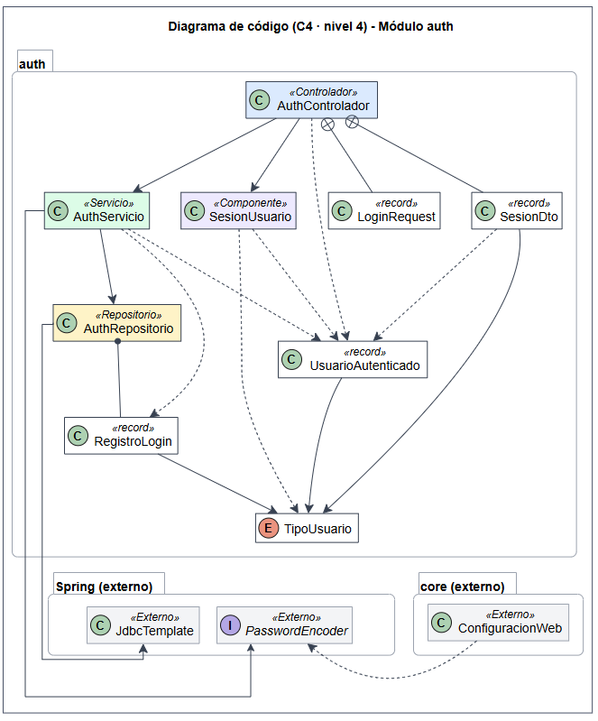
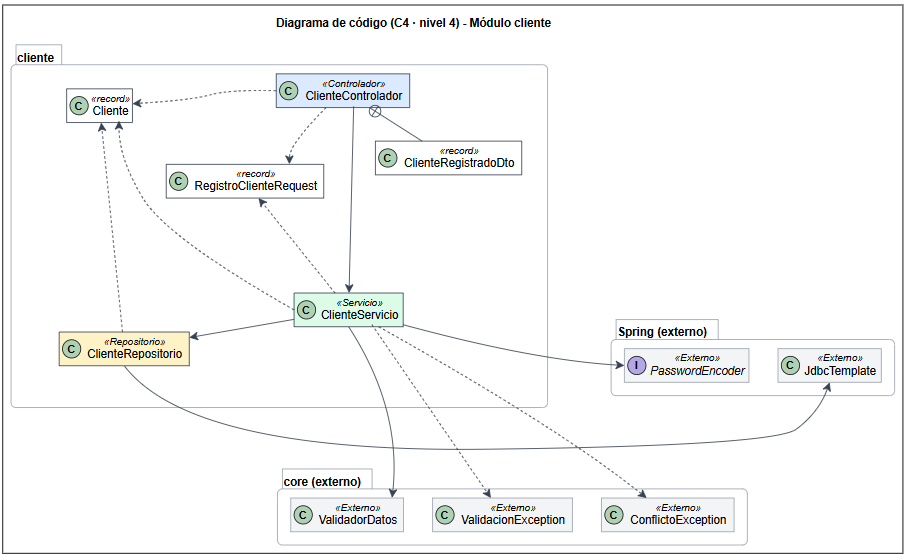
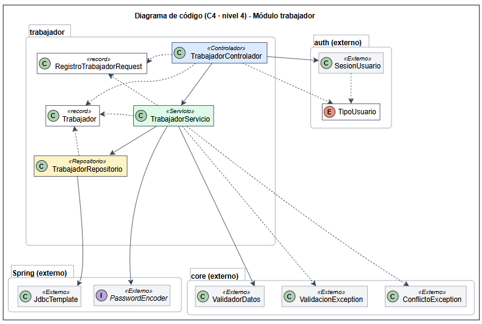
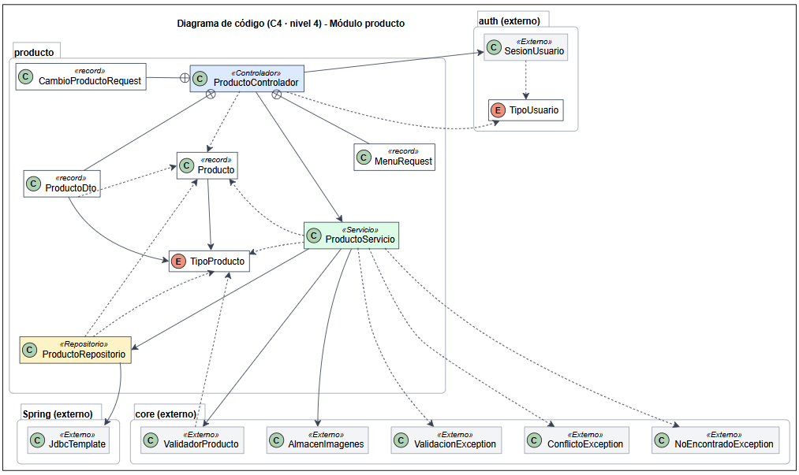
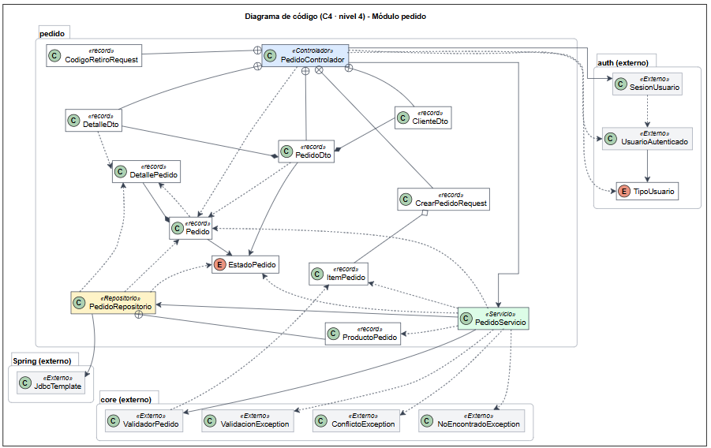
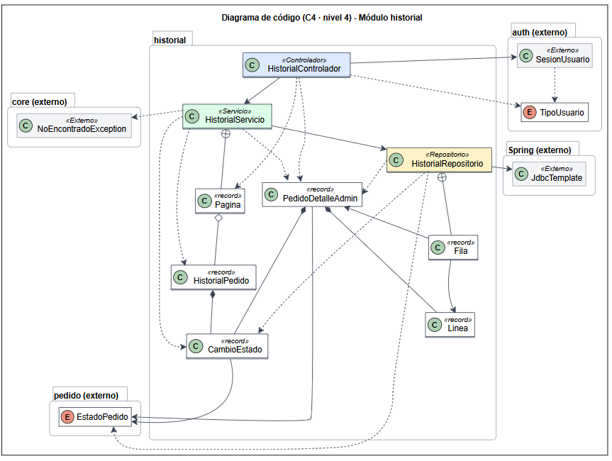
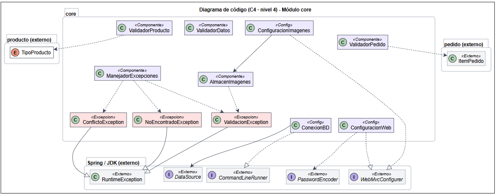

# Diagramas de Código (Nivel 4 - Modelo C4)
**Proyecto:** Sistema de Gestión de Pedidos de Cafetería Universitaria  
**Versión:** 1.0  

---

## 1. Introducción
Este documento presenta la vista a nivel de código (Nivel 4 del Modelo C4) del **Servidor Backend**. Su objetivo es mostrar cómo se organizan e interactúan las clases, registros (`records`) y enumeraciones dentro de cada módulo del sistema, manteniendo la separación de responsabilidades entre la recepción de solicitudes, las reglas de negocio y el acceso a datos.

---

## 2. Módulo `auth` (Autenticación y Sesión)

### Clases Principales y Roles
* **`AuthControlador`:** Recibe las credenciales de acceso (`LoginRequest`) y expone el estado de la sesión actual (`SesionDto`).
* **`AuthServicio`:** Valida las credenciales del usuario contra los registros almacenados y verifica el cifrado de contraseñas (`PasswordEncoder`).
* **`AuthRepositorio`:** Consulta la información básica de cuenta y rol (`RegistroLogin`) desde la base de datos.
* **`SesionUsuario`:** Componente encargado de gestionar la sesión activa del usuario y verificar su rol (`TipoUsuario`).
* **Modelos de datos (`UsuarioAutenticado`, `TipoUsuario`, `LoginRequest`, `SesionDto`, `RegistroLogin`):** Representan la identidad del usuario autenticado, los roles permitidos y las estructuras de intercambio para el inicio de sesión.

### Interacción
`AuthControlador` delega la verificación de credenciales a `AuthServicio`, el cual obtiene los datos de acceso mediante `AuthRepositorio`. Una vez validado el usuario, el controlador apoya la gestión de su estado activo en `SesionUsuario` utilizando la identidad representada por `UsuarioAutenticado`.

---

## 3. Módulo `cliente` (Gestión de Clientes)

### Clases Principales y Roles
* **`ClienteControlador`:** Expone los puntos de entrada para el registro de nuevos clientes (`RegistroClienteRequest`, `ClienteRegistradoDto`).
* **`ClienteServicio`:** Coordina las reglas de registro, verifica el formato de los datos personales (`ValidadorDatos`), cifra la contraseña e impide duplicados.
* **`ClienteRepositorio`:** Ejecuta las operaciones de lectura y almacenamiento de la información de los clientes.
* **Modelos de datos (`Cliente`, `RegistroClienteRequest`, `ClienteRegistradoDto`):** Estructuras inmutables que representan la entidad del cliente y los datos de entrada y salida de sus operaciones.

### Interacción
`ClienteControlador` recibe la solicitud de registro y la transfiere a `ClienteServicio`. Este valida la integridad de los datos con apoyo de los componentes transversales de `core`, cifra la clave y persiste el nuevo perfil `Cliente` a través de `ClienteRepositorio`.

---

## 4. Módulo `trabajador` (Gestión de Personal)

### Clases Principales y Roles
* **`TrabajadorControlador`:** Administra las solicitudes de creación y listado de cuentas del personal operativo, verificando previamente que quien opera tenga permisos de administrador mediante `SesionUsuario`.
* **`TrabajadorServicio`:** Aplica las reglas de validación de datos personales (`ValidadorDatos`), cifra las credenciales y coordina la creación o consulta del personal.
* **`TrabajadorRepositorio`:** Gestiona la persistencia y consulta de los registros de trabajadores en la base de datos.
* **Modelos de datos (`Trabajador`, `RegistroTrabajadorRequest`):** Representan al trabajador registrado y los datos requeridos para darlo de alta.

### Interacción
`TrabajadorControlador` comprueba el rol del solicitante con `SesionUsuario` y delega la operación a `TrabajadorServicio`. El servicio valida los datos, protege la contraseña y utiliza `TrabajadorRepositorio` para almacenar o recuperar la entidad `Trabajador`.

---

## 5. Módulo `producto` (Catálogo y Menú)

### Clases Principales y Roles
* **`ProductoControlador`:** Gestiona la consulta pública del menú y las operaciones de creación, edición o cambio de disponibilidad de artículos (`CambioProductoRequest`, `MenuRequest`, `ProductoDto`), validando permisos con `SesionUsuario`.
* **`ProductoServicio`:** Controla las reglas del catálogo, valida atributos mediante `ValidadorProducto` y coordina el almacenamiento de fotografías con `AlmacenImagenes`.
* **`ProductoRepositorio`:** Administra la persistencia de los artículos y su estado de disponibilidad en la base de datos.
* **Modelos de datos (`Producto`, `TipoProducto`, `ProductoDto`, `CambioProductoRequest`, `MenuRequest`):** Definen la estructura del artículo, su clasificación (`alimento` o `bebida`) y los formatos de transferencia.

### Interacción
`ProductoControlador` canaliza las consultas del catálogo o modificaciones del personal hacia `ProductoServicio`. El servicio valida la consistencia del artículo, gestiona su imagen asociada y delega la lectura o actualización de `Producto` a `ProductoRepositorio`.

---

## 6. Módulo `pedido` (Ciclo de Vida de Órdenes)

### Clases Principales y Roles
* **`PedidoControlador`:** Recibe la creación de nuevas órdenes (`CrearPedidoRequest`), las consultas de estado y las solicitudes de avance o entrega por código de retiro (`CodigoRetiroRequest`), apoyándose en `SesionUsuario` para identificar al actor.
* **`PedidoServicio`:** Valida los ítems recibidos, consolida productos repetidos, comprueba que cada producto exista, esté disponible y respete la cantidad máxima (`ProductoPedido`, `ValidadorPedido`). También controla el orden de los estados del pedido.
* **`PedidoRepositorio`:** Crea el pedido invocando la función crear_pedido de la base de datos, que registra cabecera y detalles en una transacción.
* **Modelos de datos (`Pedido`, `DetallePedido`, `ItemPedido`, `EstadoPedido`, `PedidoDto`, `DetalleDto`, `ClienteDto`, `ProductoPedido`):** Modelan la composición entre un pedido y sus detalles, los estados posibles y las vistas de respuesta.

### Interacción
`PedidoControlador` transforma la petición en estructuras de trabajo y la envía a `PedidoServicio`. Este valida los ítems (`ValidadorPedido`), construye la composición entre `Pedido` y `DetallePedido` y utiliza `PedidoRepositorio` para registrar la orden o actualizar su `EstadoPedido`.

---

## 7. Módulo `historial` (Trazabilidad y Auditoría)

### Clases Principales y Roles
* **`HistorialControlador`:** Expone las consultas paginadas del histórico de pedidos (`Pagina`) y el detalle completo de auditoría de una orden (`PedidoDetalleAdmin`), restringiendo el acceso mediante `SesionUsuario`.
* **`HistorialServicio`:** Estructura y agrupa los registros cronológicos de cambios de estado (`HistorialPedido`, `CambioEstado`) y la composición del detalle administrativo.
* **`HistorialRepositorio`:** Recupera los registros históricos y filas planas (`Fila`) desde la base de datos.
* **Modelos de datos (`HistorialPedido`, `CambioEstado`, `PedidoDetalleAdmin`, `Linea`, `Pagina`, `Fila`):** Representan la línea de tiempo de estados de cada pedido, los productos consumidos y las estructuras de paginación.

### Interacción
`HistorialControlador` verifica la sesión del administrador y solicita los registros a `HistorialServicio`. El servicio consulta `HistorialRepositorio`, reconstruye la relación entre cada `HistorialPedido` y sus respectivos `CambioEstado` y devuelve la información estructurada al controlador.

---

## 8. Módulo `core` (Componentes Transversales)

### Clases Principales y Roles
* **Configuración (`ConexionBD`, `ConfiguracionWeb`, `ConfiguracionImagenes`):** Inicializan y verifican la conexión a la base de datos, las políticas web/seguridad (`PasswordEncoder`) y la exposición de recursos gráficos.
* **Componentes utilitarios (`AlmacenImagenes`, `ValidadorDatos`, `ValidadorProducto`, `ValidadorPedido`):** Proveen servicios reutilizables para el guardado de archivos y la validación de reglas de formato y negocio en los distintos módulos.
* **Gestión de errores (`ManejadorExcepciones`, `ValidacionException`, `ConflictoException`, `NoEncontradoException`):** Interceptan las excepciones de dominio lanzadas por los servicios y las transforman en respuestas controladas y uniformes hacia el cliente.

### Interacción
Los elementos de `core` actúan como soporte transversal: las clases de configuración preparan el entorno al iniciar la aplicación, los validadores y `AlmacenImagenes` son consumidos por los servicios de negocio, y `ManejadorExcepciones` captura cualquier excepción personalizada (`ValidacionException`, `ConflictoException`, `NoEncontradoException`) para garantizar respuestas consistentes en toda la API.