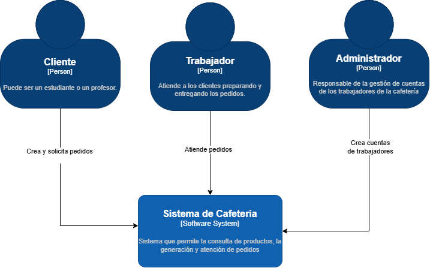
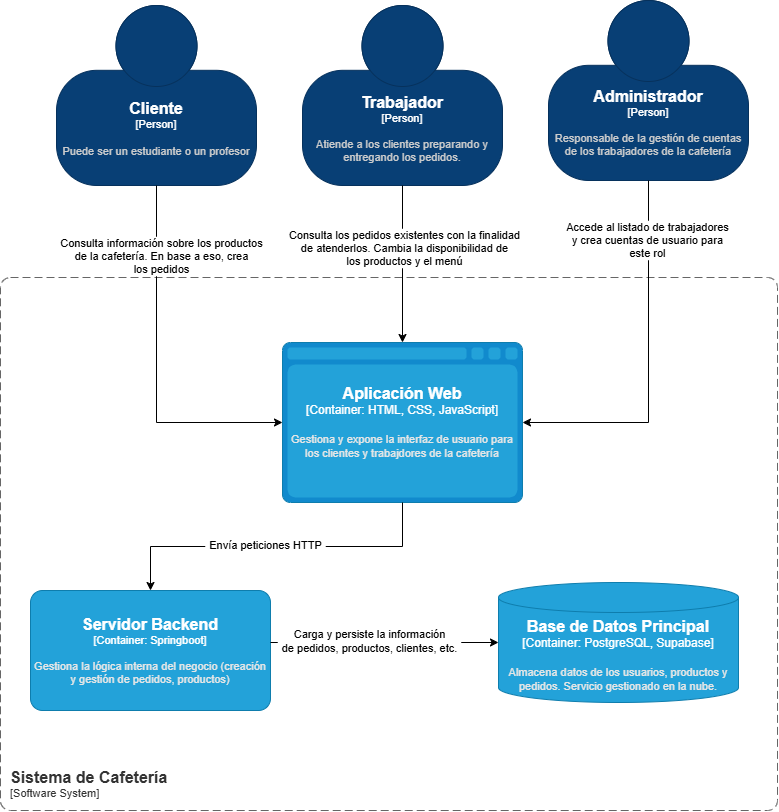
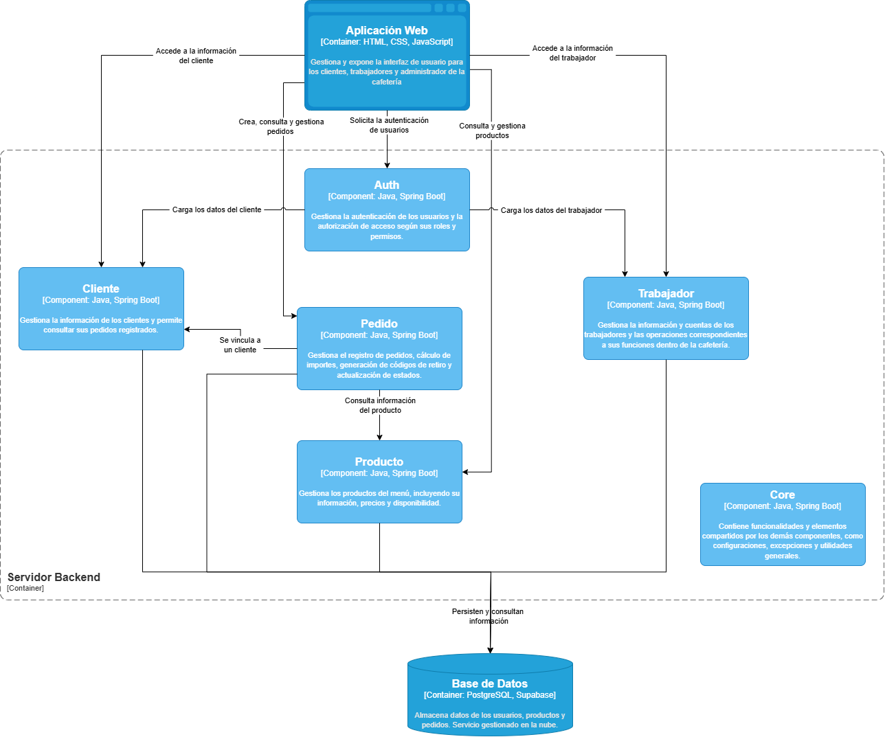
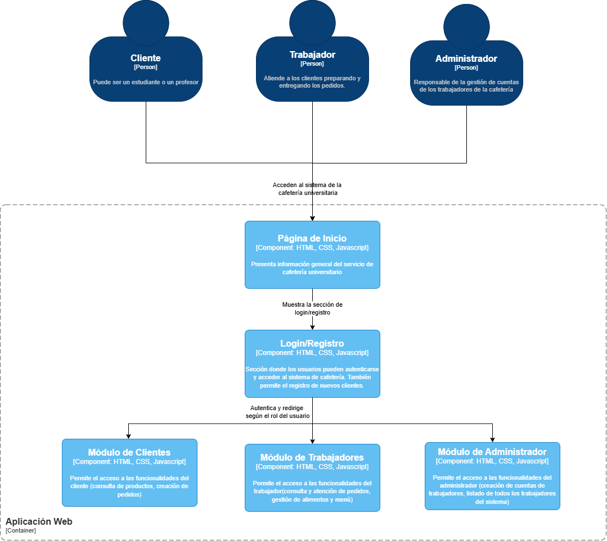

# Arquitectura de Software - Modelo C4
**Proyecto:** Sistema de Gestión de Pedidos de Cafetería Universitaria  
**Versión:** 1.0  

---

## 1. Introducción
Este documento describe la arquitectura del Sistema de Cafetería utilizando el **Modelo C4**. Su propósito es ofrecer una visión clara y progresiva de la solución —desde su entorno operativo hasta su estructura interna— para facilitar la comprensión técnica, evitar ambigüedades funcionales y respaldar la trazabilidad del sistema.

---

## 2. Nivel 1: Diagrama de Contexto del Sistema

El diagrama de contexto delimita el alcance del **Sistema de Cafetería** y su interacción con los distintos perfiles de usuario dentro de la institución.

### Elementos y Responsabilidades

* **Sistema de Cafetería `[Software System]`**: Plataforma central encargada de exponer el menú disponible, procesar las solicitudes de compra anticipada, generar los códigos únicos de retiro y gestionar el ciclo de vida de cada pedido.
* **Cliente `[Person]`**: Estudiante o docente de la institución. Interactúa con el sistema para consultar productos y precios, registrar pedidos anticipados y hacer seguimiento de su estado mediante su código de retiro.
* **Trabajador `[Person]`**: Personal operativo de la cafetería. Administra la disponibilidad y precios del menú, procesa la cola de órdenes (cambiando su estado desde *Pendiente* hasta *Listo para retirar*) y valida el código del cliente al momento de la entrega.
* **Administrador `[Person]`**: Rol incorporado por diseño arquitectónico para garantizar la seguridad, auditoría y trazabilidad operativa del sistema. Es el responsable de aprovisionar y gestionar las cuentas de acceso de los trabajadores.

### Decisiones de Alcance (Release 1.0)
* **Sin sistemas externos:** El sistema opera de forma autocontenida. No se integra con pasarelas de pago (el cobro es presencial en mostrador), servicios de mensajería ni hardware externo como impresoras térmicas o lectores de códigos.

---

## 3. Nivel 2: Diagrama de Contenedores

El diagrama de contenedores descompone el **Sistema de Cafetería** en sus unidades ejecutables y de almacenamiento de datos, detallando las responsabilidades técnicas y los mecanismos de comunicación entre ellas.

### Descripción de Contenedores

| Contenedor | Tecnología | Responsabilidad Principal |
| :--- | :--- | :--- |
| **Aplicación Web** | HTML, CSS, JavaScript | Interfaz gráfica ejecutada en el navegador web. Provee las vistas diferenciadas según el rol autenticado (catálogo y seguimiento para clientes; gestión de menú y despacho para trabajadores; administración de cuentas para el administrador). |
| **Servidor Backend** | Java, Spring Boot | Núcleo de la aplicación. Expone la API REST, valida las reglas de negocio (disponibilidad de productos, inmutabilidad de precios históricos y secuencia de estados del pedido), controla el acceso por roles y orquesta la persistencia[cite: 2, 5]. |
| **Base de Datos Principal** | PostgreSQL (Supabase) | Almacenamiento relacional gestionado en la nube. Garantiza la persistencia entre ejecuciones e integridad referencial de usuarios, productos, pedidos y sus detalles[cite: 3, 5]. |

### Flujo de Comunicación
1. **Usuarios $\rightarrow$ Aplicación Web:** Los tres roles acceden mediante navegador web vía HTTPS para operar el sistema según sus permisos.
2. **Aplicación Web $\rightarrow$ Servidor Backend:** El cliente web consume los endpoints de la API mediante peticiones **HTTP/REST (JSON)**.
3. **Servidor Backend $\rightarrow$ Base de Datos Principal:** El servidor se conecta de forma segura a la instancia PostgreSQL mediante **JDBC / JPA** para consultar y persistir transacciones.

---
  
## 4. Nivel 3: Diagrama de Componentes 

El Nivel 3 detalla la estructura interna de los dos contenedores principales de software: la **Aplicación Web** (cliente en navegador) y el **Servidor Backend** (API REST).

### 4.1. Componentes del Servidor Backend

El **Servidor Backend** sigue una arquitectura de **monolito modular**, donde cada componente representa un módulo de dominio cohesionado y desacoplado, conectándose hacia la **Aplicación Web** en su frontera superior y hacia la **Base de Datos** en su frontera inferior.

### Descripción de Componentes (Módulos)

| Componente | Tecnología | Responsabilidad Principal |
| :--- | :--- | :--- |
| **Auth** | Java, Spring Boot | Gestiona la autenticación de usuarios mediante sesiones basadas en cookies, consultando credenciales y roles. |
| **Cliente** | Java, Spring Boot | Administra la información de perfil de estudiantes y docentes. |
| **Trabajador** | Java, Spring Boot | Gestiona las cuentas del personal operativo de la cafetería (creadas por el Administrador) y sus datos asociados. |
| **Producto** | Java, Spring Boot | Administra el catálogo del menú (alimentos y bebidas), controlando sus precios vigentes y su estado de disponibilidad. |
| **Pedido** | Java, Spring Boot | Orquesta la creación de órdenes vinculadas a un `Cliente`, consulta disponibilidad y precios vigentes en `Producto`, captura el precio histórico unitario, genera el código único de retiro, controla la transición secuencial de estados (`Pendiente` $\rightarrow$ `En preparación` $\rightarrow$ `Listo para retirar` $\rightarrow$ `Entregado`) y delega el registro de auditoría en `Historial`. |
| **Historial** | Java, Spring Boot | Registra y expone el histórico de pedidos y su trazabilidad operativa para consulta y auditoría por parte del Administrador. |
| **Core** | Java, Spring Boot | Módulo transversal que centraliza configuraciones globales, manejo centralizado de excepciones, validaciones y utilidades compartidas por los módulos. |

### Estructura Interna en Capas por Módulo

Para evitar redundancia visual en los diagramas, cada módulo de dominio (`Cliente`, `Trabajador`, `Producto`, `Pedido`, `Historial`) implementa internamente una separación estándar en capas:

- **Capa de Controladores (`Controller`):** Expone los endpoints REST, recibe las solicitudes HTTP y valida los parámetros de entrada.
- **Capa de Servicios (`Service`):** Contiene la lógica y reglas de negocio del dominio correspondiente, además de coordinar las consultas y registros entre módulos (`Pedido` $\rightarrow$ `Producto`, `Pedido` $\rightarrow$ `Cliente` y `Pedido` $\rightarrow$ `Historial`).
- **Capa de Persistencia (`Repository`):** Interfaces basadas en Spring Data JPA encargadas de las operaciones de lectura y escritura contra PostgreSQL.
- **Modelo y Transferencia de Datos:** Entidades JPA mapeadas a las tablas relacionales y objetos inmutables (`Java Records` / DTOs) para el intercambio seguro de datos hacia la API.

---
### 4.2. Componentes de la Aplicación Web

La **Aplicación Web** está estructurada en vistas y módulos funcionales construidos con tecnologías web estándar (HTML, CSS y JavaScript), separando el flujo de acceso público de los paneles operativos según el rol autenticado.

#### Descripción de Componentes

| Componente | Tecnología | Responsabilidad Principal |
| :--- | :--- | :--- |
| **Página de Inicio** | HTML, CSS, JavaScript | Vista pública de entrada que presenta la información general del servicio de cafetería universitaria y dirige al flujo de acceso. |
| **Login/Registro** | HTML, CSS, JavaScript | Gestiona los formularios de inicio de sesión para todos los roles y el registro de nuevas cuentas de clientes, comunicándose con el backend para establecer la sesión mediante cookies y redirigir al módulo correspondiente. |
| **Módulo de Clientes** | HTML, CSS, JavaScript | Interfaz dedicada a estudiantes y docentes para consultar el menú disponible, armar pedidos anticipados, visualizar importes totales y consultar el estado y código de retiro de sus órdenes. |
| **Módulo de Trabajadores** | HTML, CSS, JavaScript | Panel operativo para el personal de cafetería, permitiendo administrar productos, precios y disponibilidad del menú, así como gestionar la cola de pedidos hasta su entrega. |
| **Módulo de Administrador** | HTML, CSS, JavaScript | Interfaz administrativa restringida para consultar el listado del personal y aprovisionar nuevas cuentas de trabajadores. |

---

## 5. Nivel 4: Diagramas de Código (Clases)

Para detallar la estructura interna a nivel de código sin sobrecargar la vista arquitectónica general, los diagramas de clases por cada módulo del **Servidor Backend** (`auth`, `cliente`, `trabajador`, `producto`, `pedido`, `historial` y `core`) junto con la explicación de sus componentes e interacciones se encuentran documentados en [DiagramaClases.md](./DiagramaClases.md).