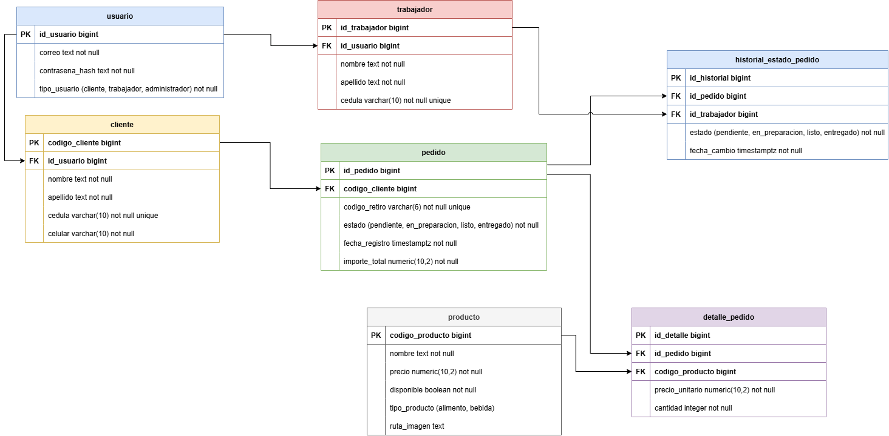

# Modelo de Datos

**Proyecto:** Sistema de Gestión de Pedidos de Cafetería Universitaria  
**Motor de Base de Datos:** PostgreSQL (Supabase)  
**Versión:** 1.0

---

## 1. Introducción

Este documento describe la estructura física y lógica de persistencia del **Sistema de Cafetería**. Su objetivo es detallar las entidades relacionales, sus atributos, restricciones de integridad y cardinalidades que garantizan la consistencia operativa de la plataforma.

---

## 2. Diagrama Relacional

---

## 3. Catálogo de Entidades (Tablas)

### 3.1. `usuario`

Centraliza las credenciales de acceso y el rol de todos los actores del sistema.

| Columna | Tipo de Dato | Restricciones | Descripción |
| :--- | :--- | :--- | :--- |
| `id_usuario` | `bigint` | `PK`, `IDENTITY` | Identificador único del usuario. |
| `correo` | `text` | `NOT NULL`, `UNIQUE (lower)`, `CHECK` | Correo electrónico institucional validado por formato. |
| `contrasena_hash` | `text` | `NOT NULL` | Hash criptográfico de la contraseña. |
| `tipo_usuario` | `tipo_usuario_enum` | `NOT NULL` | Rol del usuario (`cliente`, `trabajador`, `administrador`). |

---

### 3.2. `cliente`

Almacena los datos personales y de contacto de los estudiantes o docentes registrados.

| Columna | Tipo de Dato | Restricciones | Descripción |
| :--- | :--- | :--- | :--- |
| `codigo_cliente` | `bigint` | `PK`, `IDENTITY` | Identificador único del cliente. |
| `id_usuario` | `bigint` | `FK (usuario)`, `NOT NULL`, `UNIQUE` | Vínculo uno a uno con su cuenta de autenticación (`tipo_usuario = 'cliente'`). |
| `nombre` | `text` | `NOT NULL`, `CHECK` | Nombre(s) del cliente (no vacío). |
| `apellido` | `text` | `NOT NULL`, `CHECK` | Apellido(s) del cliente (no vacío). |
| `cedula` | `varchar(10)` | `NOT NULL`, `UNIQUE`, `CHECK` | Número de cédula ecuatoriana de 10 dígitos numéricos. |
| `celular` | `varchar(10)` | `NOT NULL`, `CHECK` | Teléfono móvil de 10 dígitos (formato `09XXXXXXXX`). |

---

### 3.3. `trabajador`

Registra la información del personal operativo de la cafetería aprovisionado por el administrador.

| Columna | Tipo de Dato | Restricciones | Descripción |
| :--- | :--- | :--- | :--- |
| `id_trabajador` | `bigint` | `PK`, `IDENTITY` | Identificador único del trabajador. |
| `id_usuario` | `bigint` | `FK (usuario)`, `NOT NULL`, `UNIQUE` | Vínculo uno a uno con su cuenta de autenticación (`tipo_usuario = 'trabajador'`). |
| `nombre` | `text` | `NOT NULL`, `CHECK` | Nombre(s) del trabajador (no vacío). |
| `apellido` | `text` | `NOT NULL`, `CHECK` | Apellido(s) del trabajador (no vacío). |
| `cedula` | `varchar(10)` | `NOT NULL`, `UNIQUE`, `CHECK` | Número de cédula de 10 dígitos numéricos. |

---

### 3.4. `producto`

Define los artículos (alimentos y bebidas) ofrecidos en el menú de la cafetería.

| Columna | Tipo de Dato | Restricciones | Descripción |
| :--- | :--- | :--- | :--- |
| `codigo_producto` | `bigint` | `PK`, `IDENTITY` | Identificador único del producto. |
| `nombre` | `text` | `NOT NULL`, `UNIQUE (lower)`, `CHECK` | Nombre comercial único del producto. |
| `precio` | `numeric(10,2)` | `NOT NULL`, `CHECK (> 0)` | Precio unitario vigente en el menú. |
| `disponible` | `boolean` | `NOT NULL`, `DEFAULT true` | Indica si el producto puede incluirse en nuevos pedidos. |
| `tipo_producto` | `tipo_producto_enum` | `NOT NULL` | Categoría del artículo (`bebida`, `alimento`). |
| `ruta_imagen` | `text` | `NULL`, `CHECK` | Ruta relativa validada del recurso gráfico asociado. |

---

### 3.5. `pedido`

Representa la cabecera de una solicitud anticipada realizada por un cliente.

| Columna | Tipo de Dato | Restricciones | Descripción |
| :--- | :--- | :--- | :--- |
| `id_pedido` | `bigint` | `PK`, `IDENTITY` | Identificador interno del pedido. |
| `codigo_cliente` | `bigint` | `FK (cliente)`, `NOT NULL` | Cliente que registra el pedido. |
| `codigo_retiro` | `varchar(6)` | `NOT NULL`, `UNIQUE` | Código alfanumérico único de 6 caracteres para entrega en mostrador. |
| `estado` | `estado_pedido_enum` | `NOT NULL`, `DEFAULT 'pendiente'` | Etapa actual (`pendiente`, `en_preparacion`, `listo`, `entregado`). |
| `fecha_registro` | `timestamptz` | `NOT NULL`, `DEFAULT now()` | Marca de tiempo exacta de confirmación del pedido. |
| `importe_total` | `numeric(10,2)` | `NOT NULL`, `DEFAULT 0`, `CHECK (>= 0)` | Suma acumulada de los subtotales de su detalle. |

---

### 3.6. `detalle_pedido`

Desglosa los productos y cantidades solicitadas dentro de un pedido, preservando el precio histórico.

| Columna | Tipo de Dato | Restricciones | Descripción |
| :--- | :--- | :--- | :--- |
| `id_detalle` | `bigint` | `PK`, `IDENTITY` | Identificador único de la línea de detalle. |
| `id_pedido` | `bigint` | `FK (pedido)`, `NOT NULL`, `ON DELETE CASCADE` | Pedido al que pertenece el ítem. |
| `codigo_producto` | `bigint` | `FK (producto)`, `NOT NULL` | Producto solicitado. |
| `precio_unitario` | `numeric(10,2)` | `NOT NULL`, `CHECK (> 0)` | Precio unitario congelado al momento de confirmar el pedido. |
| `cantidad` | `integer` | `NOT NULL`, `CHECK (> 0)` | Cantidad entera positiva solicitada del producto. |

---

### 3.7. `historial_estado_pedido`

Registra la auditoría cronológica de cada transición de estado de un pedido y el trabajador responsable.

| Columna | Tipo de Dato | Restricciones | Descripción |
| :--- | :--- | :--- | :--- |
| `id_historial` | `bigint` | `PK`, `IDENTITY` | Identificador único del evento de auditoría. |
| `id_pedido` | `bigint` | `FK (pedido)`, `NOT NULL`, `ON DELETE CASCADE` | Pedido auditado. |
| `id_trabajador` | `bigint` | `FK (trabajador)`, `NULL` | Trabajador que ejecutó el cambio (`NULL` únicamente en el estado inicial `pendiente`). |
| `estado` | `estado_pedido_enum` | `NOT NULL` | Estado registrado en la transición. |
| `fecha_cambio` | `timestamptz` | `NOT NULL`, `DEFAULT now()` | Fecha y hora en que ocurrió el cambio de estado. |

*(Restricción compuesta: `UNIQUE (id_pedido, estado)` asegura que un pedido no repita ni retroceda a un estado ya registrado).*

---

## 4. Resumen de Relaciones y Cardinalidades

* **`usuario` — `cliente` (`1 : 0..1`):** Un usuario con rol `cliente` posee exactamente un perfil en `cliente`. La eliminación está restringida (`ON DELETE RESTRICT`).
* **`usuario` — `trabajador` (`1 : 0..1`):** Un usuario con rol `trabajador` posee exactamente un perfil en `trabajador`. La eliminación está restringida (`ON DELETE RESTRICT`). *(Los usuarios con rol `administrador` residen únicamente en `usuario`)*.
* **`cliente` — `pedido` (`1 : 0..*`):** Un cliente puede registrar múltiples pedidos a lo largo del tiempo, pero cada pedido pertenece a un único cliente.
* **`pedido` — `detalle_pedido` (`1 : 1..*`):** Un pedido se compone de al menos un detalle. Si se elimina el pedido, sus detalles se eliminan en cascada (`ON DELETE CASCADE`).
* **`producto` — `detalle_pedido` (`1 : 0..*`):** Un producto puede aparecer en múltiples detalles de distintos pedidos. No se permite eliminar un producto referenciado (`ON DELETE RESTRICT`).
* **`pedido` — `historial_estado_pedido` (`1 : 1..*`):** Cada pedido genera un registro inicial (`pendiente`) y acumula hasta cuatro registros secuenciales conforme avanza hasta `entregado`.
* **`trabajador` — `historial_estado_pedido` (`0..1 : 0..*`):** Un trabajador atiende y registra múltiples cambios de estado; el registro inicial `pendiente` no tiene trabajador asociado.