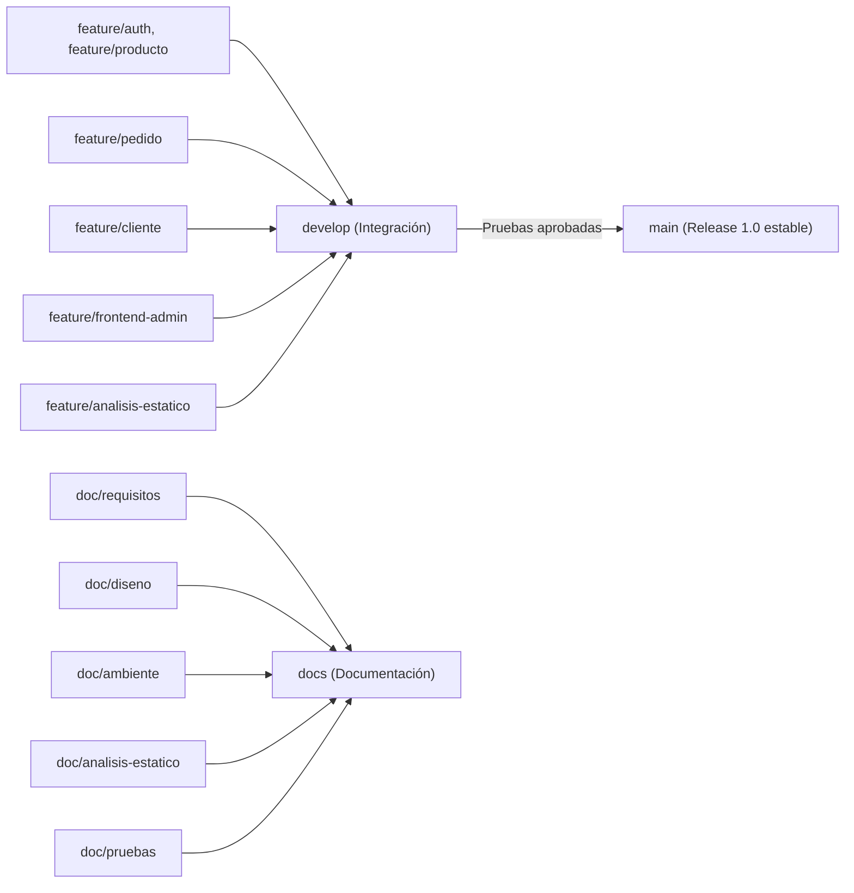

# Documentación del Ambiente de Desarrollo y Estrategia de Ramificación

**Proyecto:** Sistema de gestión de pedidos de una cafetería universitaria (`g5.backend:cafeteria`)  
**Versión:** 1.0 (Release 1.0)  
**Fecha:** 21 de noviembre de 2026  
**Responsable:** Integrante 4  
**Colaboradores:** Integrante 1, Integrante 2 e Integrante 3  

---

## 1. Propósito del documento

Este documento define las herramientas, versiones, estructura del proyecto, configuración del ambiente local y estrategia de control de versiones (Git) que utiliza el equipo para construir, integrar y mantener el Release 1.0 del sistema de gestión de pedidos de la cafetería universitaria.

---

## 2. Herramientas seleccionadas

### 2.1. Stack tecnológico de la aplicación

| Capa | Tecnología / Herramienta | Versión / Detalle | Justificación |
| :--- | :--- | :--- | :--- |
| **Lenguaje Backend** | Java (JDK) | Java 25 | Lenguaje orientado a objetos robusto, compatible con JavaDoc y herramientas de análisis estático estándar. |
| **Framework Backend** | Spring Boot | 4.2.0 (`spring-boot-starter-parent`) | Facilita la creación de servicios REST (`webmvc`), persistencia (`data-jpa`) y validaciones (`validation`). |
| **Gestor de proyecto y build** | Apache Maven | Maven Wrapper (`mvnw` / `mvnw.cmd`) | Garantiza compilación reproducible en todos los equipos sin depender de una instalación manual previa de Maven. |
| **Base de datos** | Supabase (PostgreSQL) | PostgreSQL administrado con SSL (`sslmode=require`) | Persistencia relacional centralizada entre ejecuciones y accesible para todo el equipo durante el desarrollo. |
| **Driver y ORM** | PostgreSQL JDBC + Spring Data JPA / Hibernate | Gestionados por Spring Boot 4.2.0 (`ddl-auto=validate`) | Integración directa entre entidades Java y el esquema relacional de Supabase. |
| **Productividad Backend** | Project Lombok + Spring Boot DevTools | Gestionados por Spring Boot 4.2.0 | Reduce código repetitivo y agiliza el reinicio durante pruebas locales. |
| **Frontend (Cliente y Admin)** | HTML5, CSS3 y JavaScript (ES6+ modular) | Estándar web nativo | Sin dependencias pesadas de compilación; servido directamente desde `cafeteria/src/main/resources/static/` por Spring Boot. |

### 2.2. Herramientas de desarrollo, pruebas y calidad

| Categoría | Herramienta | Uso en el proyecto |
| :--- | :--- | :--- |
| **IDE / Editor** | IntelliJ IDEA / Visual Studio Code | Desarrollo del backend Spring Boot, edición de frontend HTML/CSS/JS y documentación Markdown. |
| **Control de versiones** | Git + GitHub | Gestión de ramas, historial de cambios, Pull Requests y revisión de código entre pares. |
| **Pruebas de API** | Postman / Insomnia | Verificación de endpoints REST (`auth`, `producto`, `pedido`, `trabajador`) antes y durante la integración con frontend. |
| **Pruebas automatizadas** | JUnit 5 + Spring Boot Test | Pruebas unitarias y de integración del backend (`spring-boot-starter-*-test`). |
| **Documentación técnica** | JavaDoc + JSDoc | Documentación en código fuente Java y módulos JavaScript. |
| **Análisis estático (Backend)** | Checkstyle, PMD y SpotBugs (plugins Maven) | Verificación de estilo, complejidad, código duplicado y detección temprana de posibles errores en Java. |
| **Análisis estático (Frontend)** | ESLint y HTMLHint | Verificación de buenas prácticas en JavaScript y validez semántica de HTML. |

---

## 3. Estructura del proyecto en el repositorio

El código fuente de la aplicación se organiza dentro de la carpeta `cafeteria/` en la rama `develop` y `main`:

```text
Proyecto-Construccion/
├── README.md
└── cafeteria/
    ├── pom.xml                                  # Dependencias, plugins Maven y configuración de Java 25
    ├── mvnw / mvnw.cmd                          # Maven Wrapper para Linux/macOS y Windows
    └── src/
        ├── main/
        │   ├── java/g5/backend/cafeteria/
        │   │   ├── CafeteriaApplication.java    # Punto de entrada Spring Boot
        │   │   ├── core/                        # Verificación de conexión a BD y utilidades compartidas
        │   │   ├── auth/                        # Autenticación y gestión de sesiones/roles
        │   │   ├── cliente/                     # Entidad y lógica de clientes
        │   │   ├── trabajador/                  # Entidad y gestión de trabajadores/administrador
        │   │   ├── producto/                    # Gestión del menú y disponibilidad
        │   │   └── pedido/                      # Pedidos, detalles, estados e historial
        │   └── resources/
        │       ├── application.properties       # Configuración de Spring Boot y conexión a Supabase
        │       └── static/                      # Recursos estáticos servidos por Spring Boot
        │           ├── index.html               # Entrada principal / módulo cliente
        │           └── admin/                   # Módulo de Frontend Administrativo (Trabajador y Admin)
        └── test/
            └── java/g5/backend/cafeteria/       # Pruebas unitarias y de integración
```

---

## 4. Configuración del ambiente local

### 4.1. Prerrequisitos
1. Instalar **JDK 25** y verificar que `JAVA_HOME` apunte a la instalación correspondiente:
   ```bash
   java -version
   ```
2. Instalar **Git** y configurar identidad local del integrante:
   ```bash
   git config --global user.name "Nombre Apellido"
   git config --global user.email "correo@epn.edu.ec"
   ```
3. Contar con acceso a Internet para la conexión hacia **Supabase (PostgreSQL)** y la descarga inicial de dependencias Maven.

### 4.2. Clonación y ejecución inicial
1. Clonar el repositorio y cambiar a la rama `develop`:
   ```bash
   git clone https://github.com/ViKunn/Proyecto-Construccion.git
   cd Proyecto-Construccion
   git checkout develop
   ```
2. Ingresar al directorio del proyecto Spring Boot y compilar con Maven Wrapper:
   - En **Windows (PowerShell / CMD)**:
     ```powershell
     cd cafeteria
     .\mvnw.cmd clean compile
     ```
   - En **Linux / macOS**:
     ```bash
     cd cafeteria
     ./mvnw clean compile
     ```
3. Ejecutar la aplicación:
   - En **Windows**:
     ```powershell
     .\mvnw.cmd spring-boot:run
     ```
   - Al iniciar, `ConexionBD` valida automáticamente la conexión con Supabase y registra el estado en consola.
4. Acceder desde el navegador:
   - Portal principal: `http://localhost:8080/`
   - Panel administrativo: `http://localhost:8080/admin/index.html`

> **Nota de buenas prácticas sobre credenciales:** En etapas previas a despliegue en producción se recomienda externalizar las credenciales de `application.properties` (`spring.datasource.url`, `username`, `password`) mediante variables de entorno del sistema para evitar exponer secretos en el repositorio.

---

## 5. Estrategia de ramificación (Git Branching Strategy)

El proyecto utiliza una estrategia basada en **Git Flow simplificado**, adaptada al tamaño del equipo (4 integrantes) y al alcance del Release 1.0.

### 5.1. Ramas principales

| Rama | Propósito | Regla de protección |
| :--- | :--- | :--- |
| **`main`** | Contiene exclusivamente versiones funcionales, verificadas y estables de la aplicación (Release 1.0). | No se realizan commits directos; solo recibe Pull Requests probados desde `develop`. |
| **`develop`** | Rama de integración continua donde convergen las funcionalidades desarrolladas por todos los integrantes. | Recibe Pull Requests revisados desde ramas `feature/*`. |
| **`docs`** | Contiene toda la documentación técnica y académica del proyecto (los 8 entregables documentales). | Recibe Pull Requests revisados desde ramas `doc/*`. |

### 5.2. Ramas temporales

Para trabajar en paralelo sin interferir entre módulos, cada integrante crea ramas temporales según el tipo de tarea:

- **`feature/<nombre>`** (nacen desde `develop` y se integran en `develop`):
  - Ejemplos: `feature/auth`, `feature/producto`, `feature/pedido`, `feature/cliente`, `feature/frontend-admin`, `feature/analisis-estatico`.
- **`doc/<nombre>`** (nacen desde `docs` y se integran en `docs`):
  - Se utiliza el prefijo singular `doc/` (y no `docs/`) porque en Git una rama principal llamada `docs` (`refs/heads/docs`) impide crear referencias hijas bajo `docs/*`.
  - Ejemplos: `doc/requisitos`, `doc/diseno`, `doc/ambiente`, `doc/analisis-estatico`, `doc/pruebas`, `doc/manual-instalacion`, `doc/manual-usuario`.

### 5.3. Diagrama del flujo de trabajo



---

## 6. Flujo de integración y buenas prácticas Git

### 6.1. Procedimiento paso a paso para cada integrante
1. **Actualizar la rama base antes de iniciar una tarea:**
   ```bash
   git fetch --all --prune
   git checkout develop
   git pull origin develop
   ```
   *(Para documentación, usar `docs` en lugar de `develop`.)*
2. **Crear la rama temporal correspondiente:**
   ```bash
   git checkout -b feature/nombre-funcionalidad
   ```
3. **Registrar cambios con commits pequeños y descriptivos:**
   ```bash
   git add <archivos>
   git commit -m "feat: descripción clara del cambio"
   ```
4. **Publicar la rama y crear un Pull Request (PR):**
   ```bash
   git push -u origin feature/nombre-funcionalidad
   ```
   En GitHub, abrir un Pull Request hacia `develop` (código) o `docs` (documentación).
5. **Revisión entre pares:**
   - Otro integrante del equipo revisa los cambios, verifica que el código compile o que el documento esté completo y aprueba el Pull Request.
6. **Integración y liberación:**
   - Las funcionalidades aprobadas se fusionan en `develop`, donde se ejecutan las pruebas de integración.
   - Una vez verificada la estabilidad completa del sistema, se realiza un Pull Request de `develop` hacia `main` para publicar el **Release 1.0**.

### 6.2. Convención de mensajes de commit

Se adopta el estándar **Conventional Commits** en español:

| Prefijo | Cuándo utilizarlo | Ejemplo |
| :--- | :--- | :--- |
| `feat:` | Nueva funcionalidad o módulo | `feat: agregar panel de pedidos para trabajador` |
| `fix:` | Corrección de un error o defecto | `fix: validar estado listo antes de entregar pedido` |
| `docs:` | Creación o actualización de documentación | `docs: agregar guia de ambiente de desarrollo y Git` |
| `refactor:` | Mejora interna de código sin cambiar comportamiento | `refactor: centralizar cliente HTTP en httpClient.js` |
| `test:` | Creación o ajuste de pruebas | `test: agregar pruebas de validacion de codigo de retiro` |
| `chore:` | Tareas de configuración, build o herramientas | `chore: configurar Checkstyle y PMD en pom.xml` |

### 6.3. Reglas de higiene del repositorio
- No subir archivos compilados (`target/`), temporales del IDE ni dependencias locales (`node_modules/`).
- Mantener el historial limpio: cada commit debe corresponder únicamente al integrante autor, sin metadatos externos ni co-autores no pertenecientes al equipo.
- Resolver conflictos trayendo los cambios actualizados de `develop` antes de finalizar el Pull Request.
