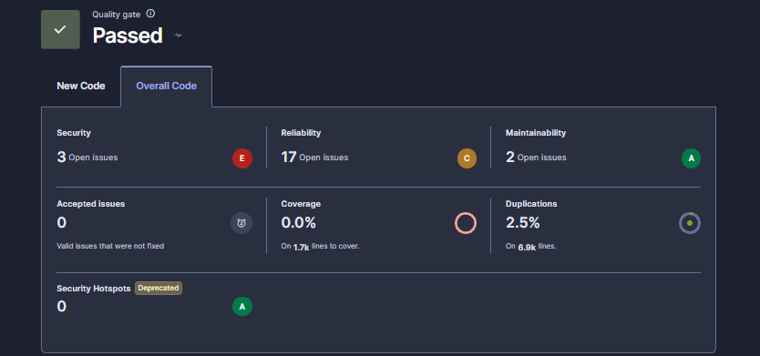
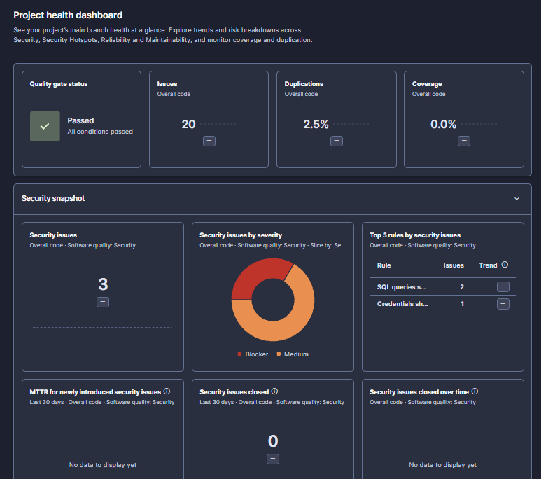
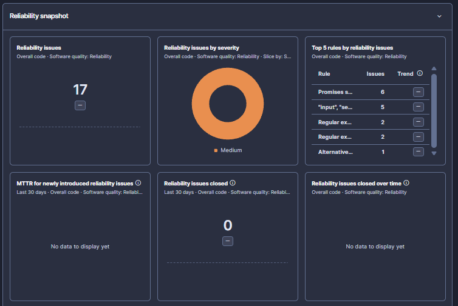
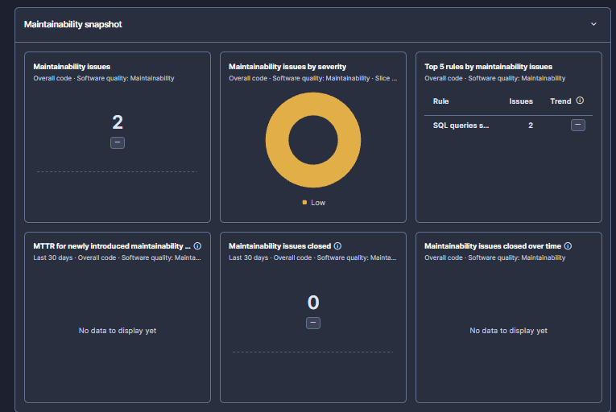

# Reporte de Análisis Estático del Código

**Proyecto:** Sistema de gestión de pedidos de una cafetería universitaria (`g5.backend:cafeteria`)  
**Versión:** 1.1 (Línea base + SonarQube Community + Correcciones Frontend Admin)  
**Fechas de ejecución:** 22 y 23 de noviembre de 2026  
**Responsable:** Integrante 4  
**Colaboradores:** Integrante 1 e Integrante 2  

---

## 1. Propósito y alcance

Este reporte documenta la configuración, ejecución y análisis de los resultados obtenidos mediante herramientas de análisis estático sobre el código fuente del proyecto (Backend Spring Boot en Java 25 y Frontend Administrativo en HTML5/CSS3/JavaScript ES6+), con el objetivo de detectar defectos tempranos, vulnerabilidades de seguridad, problemas de accesibilidad y malas prácticas antes del Release 1.0.

---

## 2. Herramientas seleccionadas y comandos de ejecución

| Capa | Herramienta | Versión | Alcance analizado | Reglas / Archivo de configuración |
| :--- | :--- | :--- | :--- | :--- |
| **Integral (Java + JS + HTML + CSS)** | **SonarQube Community** (Docker + `sonar-maven-plugin`) | 5.9.0.7382 | Backend completo (`src/main/java`) y Frontend (`src/main/resources/static`) | Quality Gate estándar, Security, Reliability, Maintainability y Duplications |
| **Backend (Java 25)** | `maven-checkstyle-plugin` | 3.6.0 | 46+ clases Java (`src/main` y `src/test`) | `cafeteria/config/checkstyle/checkstyle.xml` |
| **Backend (Java 25)** | `maven-pmd-plugin` (PMD) | 3.28.0 (PMD 7.17.0) | 46+ clases Java | Reglas estándar de buenas prácticas, código muerto y complejidad |
| **Backend (Java 25)** | `spotbugs-maven-plugin` | 4.9.8.0 | Bytecode compilado (`target/classes`) | Detección de defectos (`effort=Max`, `threshold=Low`) |
| **Frontend (JS / HTML)** | ESLint + HTMLHint | Flat Config / CLI | 13 módulos JS y 3 vistas HTML (`static/admin/`) | `cafeteria/eslint.config.mjs` y `cafeteria/.htmlhintrc` |

### Comandos reproducibles

- **SonarQube Community (Docker + Maven, dentro de `cafeteria/` con JDK 25):**
  ```powershell
  .\mvnw.cmd clean verify org.sonarsource.scanner.maven:sonar-maven-plugin:sonar `
    "-Dsonar.projectKey=cafeteria" `
    "-Dsonar.projectName=Cafeteria Universitaria" `
    "-Dsonar.host.url=http://localhost:9000" `
    "-Dsonar.token=<TOKEN>" `
    "-Dsonar.sources=src/main/java,src/main/resources/static"
  ```
- **Checkstyle, PMD y SpotBugs (Maven):**
  ```powershell
  .\mvnw.cmd clean compile checkstyle:check pmd:check spotbugs:check
  ```
- **ESLint y HTMLHint (Frontend):**
  ```powershell
  npx eslint src/main/resources/static/admin/js
  npx htmlhint src/main/resources/static/admin/*.html
  ```

---

## 3. Análisis con SonarQube Community (23 de noviembre de 2026)

### 3.1. Línea base inicial (20 issues totales)

En la primera corrida completa sobre `src/main/java` y `src/main/resources/static` (6.9k líneas analizadas, 2.5% de duplicación), SonarQube reportó:

- **Quality Gate:** Passed
- **Security:** calificación **E** — **3 issues** (1 Blocker, 2 Major)
- **Reliability:** calificación **C** — **17 issues** (todos Major)
- **Maintainability:** calificación **A** — **2 issues** (Low/Major)
- **Duplications:** **2.5%**

#### Evidencias visuales de la línea base en SonarQube









---

### 3.2. Hallazgos en Frontend Administrativo (12 issues — **Resueltos a 0**)

| Severidad | Regla | Archivo y línea | Hallazgo detectado | Corrección aplicada | Estado |
| :---: | :--- | :--- | :--- | :--- | :---: |
| **MAJOR** | `Web:InputWithoutLabelCheck` | `panel-administrador.html:119, 152`<br>`panel-trabajador.html:212, 213, 218` | 5 campos de búsqueda/filtro sin `<label>` asociado (accesibilidad). | Se creó la clase `.sr-only` en `styles.css` y se asociaron etiquetas `<label for="...">` a los 5 controles. | **Resuelto** |
| **MAJOR** | `javascript:S9383` | `administrador.js:333, 340, 346, 352, 358`<br>`trabajador.js:758` | 6 invocaciones a funciones `async` sin `await` ni operador `void`. | Se marcó explícitamente el descarte controlado con `void` (las funciones ya gestionan sus errores con `try/catch`). | **Resuelto** |
| **MAJOR** | `javascript:S8786` | `validators.js:21` | Expresión regular de correo con posible *backtracking* super-lineal. | Se reemplazó por validación en tiempo lineal mediante `split("@")` y verificación de dominio. | **Resuelto** |

Tras re-ejecutar SonarQube sobre `feature/admin-cambio-contrasena`, **los 12 hallazgos del Frontend Administrativo desaparecieron por completo (0 issues en `static/admin/`)**.

---

### 3.3. Hallazgos en Backend Java (8 issues — Pendientes de corrección por Integrantes 1 y 2)

| Severidad | Tipo | Regla | Archivo y línea | Descripción del hallazgo | Responsable |
| :---: | :--- | :--- | :--- | :--- | :---: |
| **BLOCKER** | Vulnerability | `java:S6437` | `auth/AuthServicio.java:32` | Credencial/contraseña detectada en código fuente (origina calificación **E** en Security). | Integrante 1 |
| **MAJOR** | Vulnerability | `java:S2077` | `historial/HistorialRepositorio.java:72` | Consulta SQL formateada dinámicamente; verificar parametrización segura. | Integrante 1 |
| **MAJOR** | Vulnerability | `java:S2077` | `pedido/PedidoRepositorio.java:96` | Consulta SQL formateada dinámicamente; verificar parametrización segura. | Integrante 2 |
| **MAJOR** | Bug | `java:S5998` | `core/ValidadorDatos.java:20, 22` | Dos expresiones regulares con repetición que pueden provocar `StackOverflowError` ante entradas grandes. | Integrante 1 |
| **MAJOR** | Bug | `java:S5850` | `core/AlmacenImagenes.java:128` | Agrupar partes de la expresión regular para hacer explícita la precedencia del operador `\|`. | Integrante 1 |
| **MAJOR** | Code Smell | `java:S8786` | `core/AlmacenImagenes.java:128, 130` | Simplificar expresiones regulares para evitar *backtracking* super-lineal. | Integrante 1 |

---

## 4. Análisis complementario (Checkstyle, PMD, SpotBugs, ESLint y HTMLHint)

### 4.1. Resumen cuantitativo (Línea base — 22 de noviembre de 2026)

| Herramienta | Archivos analizados | Errores Críticos / Altos | Hallazgos Medios / Advertencias | Hallazgos Bajos | Estado |
| :--- | :---: | :---: | :---: | :---: | :---: |
| **Checkstyle 3.6.0** | 46 clases Java | 0 | 9 advertencias | 0 | Con advertencias de estilo |
| **PMD 7.17.0** | 46 clases Java | 0 | 0 | 0 | Limpio |
| **SpotBugs 4.9.8.0** | 46 clases Java | 0 | 37 | 4 | 8 hallazgos técnicos prioritarios |
| **ESLint** | 13 archivos JS | 0 | 0 | 0 | Limpio |
| **HTMLHint** | 3 archivos HTML | 0 | 0 | 0 | Limpio |

### 4.2. Principales hallazgos complementarios para el equipo backend
- **Checkstyle (9 advertencias):** 3x `ConstantName` (`log` en `AuthServicio.java:13`, `AlmacenImagenes.java:27`, `ConexionBD.java:15`) y 6x `LineLength` (>120 caracteres en `PedidoRepositorio.java`, `PedidoServicio.java` y `ProductoRepositorio.java`).
- **SpotBugs (8 hallazgos técnicos prioritarios):** posible `NullPointerException` en `AlmacenImagenes.java:77`, excepción en constructor `AlmacenImagenes.java:40`, boxing/unboxing innecesario en `ProductoRepositorio.java:63`, y 5 lambdas de `PreparedStatementCreator` en `HistorialRepositorio`, `PedidoRepositorio` y `ProductoRepositorio` (`OBL_UNSATISFIED_OBLIGATION_EXCEPTION_EDGE`).

---

## 5. Seguimiento y comparativa (Antes vs Después)

| Herramienta / Módulo | 1.ª Ejecución (Línea base) | Ejecución intermedia (23 nov) | Ejecución final (26 nov) |
| :--- | :---: | :---: | :---: |
| **SonarQube — Frontend Admin (`static/admin/`)** | 12 issues | **0 issues** *(Resuelto)* | *Por verificar con Frontend Cliente* |
| **SonarQube — Backend Java (`src/main/java/`)** | 8 issues (1 Blocker) | 8 issues *(En corrección por Int. 1 y 2)* | *Pendiente* |
| **ESLint + HTMLHint (Frontend Admin)** | 0 errores | **0 errores** | *Pendiente* |
| **PMD (Backend Java)** | 0 violaciones | 0 violaciones | *Pendiente* |
| **Checkstyle (Backend Java)** | 9 advertencias | 9 advertencias | *Pendiente* |
| **SpotBugs (Backend prioritarios)** | 8 hallazgos | 8 hallazgos | *Pendiente* |
