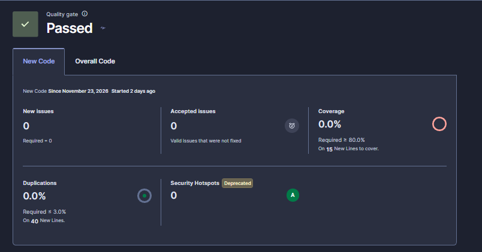
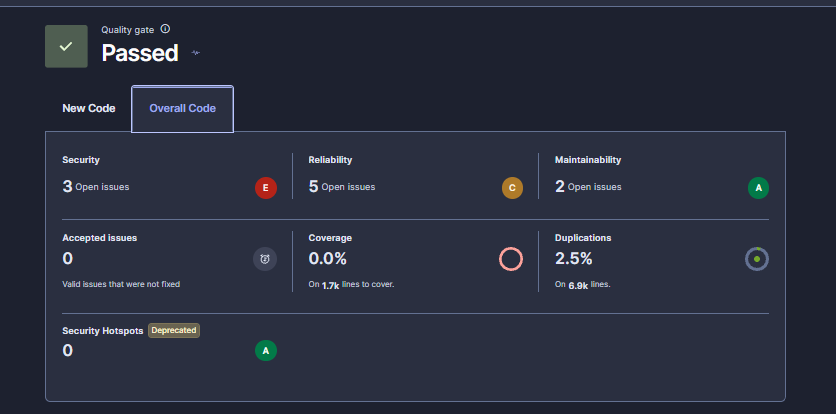
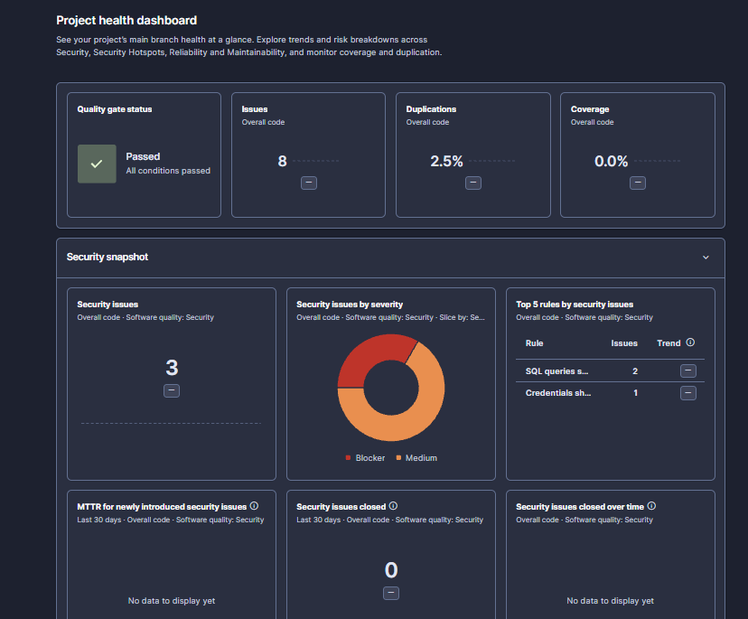
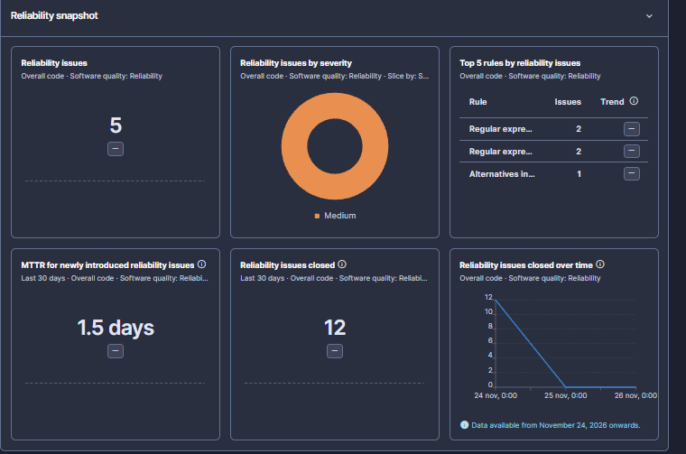
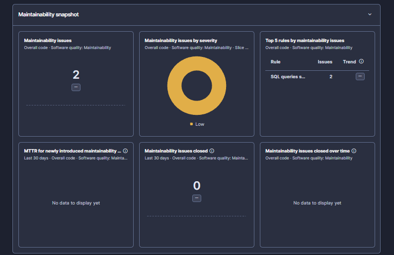

# Reporte de Análisis Estático del Código — Versión 2 (Segunda Ejecución)

**Proyecto:** Sistema de gestión de pedidos de una cafetería universitaria (`g5.backend:cafeteria`)  
**Versión del reporte:** 2.0 (Verificación posterior a correcciones — Release 1.0)  
**Fecha de 2.ª ejecución:** 26 de noviembre de 2026  
**Responsable:** Integrante 4  
**Colaboradores:** Integrante 1 e Integrante 2  
**Referencia de línea base:** [Reporte_Analisis_Estatico.md](Reporte_Analisis_Estatico.md) *(Versión 1 — 20 issues)*

---

## 1. Propósito de esta segunda ejecución

Este documento registra los resultados de la **segunda ejecución** de análisis estático con **SonarQube Community** tras aplicar las correcciones de accesibilidad, manejo de promesas y expresiones regulares en el Frontend Administrativo (`static/admin/`), permitiendo contrastar de forma directa la reducción de hallazgos frente a la Versión 1 (`Reporte_Analisis_Estatico.md`).

---

## 2. Comparativa directa: Versión 1 (Antes) vs Versión 2 (Después)

| Métrica en SonarQube | Versión 1 (23 nov 2026) | Versión 2 (26 nov 2026) | Variación |
| :--- | :---: | :---: | :---: |
| **Quality Gate** | Passed | **Passed** | Mantenido |
| **Total de issues abiertos** | 20 | **8** | **-12 (-60%)** |
| **New Code — Nuevos issues** | — | **0** | Limpio |
| **New Code — Duplicaciones** | — | **0.0%** | Limpio |
| **Reliability (Confiabilidad)** | 17 issues (C) | **5 issues (C)** | **-12 issues cerrados** |
| **Security (Seguridad)** | 3 issues (E) | **3 issues (E)** | Sin cambio *(backend)* |
| **Maintainability (Mantenibilidad)** | 2 issues (A) | **2 issues (A)** | Mantenido |
| **Issues en Frontend Admin (`static/admin/`)** | 12 issues | **0 issues** | **-12 (-100%)** |
| **Issues en Backend Java (`src/main/java/`)** | 8 issues | **8 issues** | Pendiente en backend |

---

## 3. Evidencias visuales de la Versión 2 (SonarQube Community)

### 3.1. Código nuevo (`New Code` — 0 issues nuevos, 0.0% duplicación)

### 3.2. Resumen general (`Overall Code` — 8 issues totales)

### 3.3. Panel de salud y Seguridad (`Issues: 8`, `Security: 3`)

### 3.4. Confiabilidad (`Reliability: 5 abiertos`, **`12 issues cerrados`**)

### 3.5. Mantenibilidad (`Maintainability: 2 Low`, calificación **A**)

---

## 4. Detalle de los 12 issues resueltos entre Versión 1 y Versión 2

| Cantidad | Regla SonarQube | Archivos intervenidos | Corrección aplicada | Estado en v2 |
| :---: | :--- | :--- | :--- | :---: |
| **5** | `Web:InputWithoutLabelCheck` | `panel-administrador.html:119, 152` `panel-trabajador.html:212, 213, 218` | Se creó la clase accesible `.sr-only` en `styles.css` y se asoció `<label for="...">` a cada campo de filtro/búsqueda. | **Cerrado (0)** |
| **6** | `javascript:S9383` | `administrador.js:333, 340, 346, 352, 358` `trabajador.js:758` | Se antepuso el operador `void` en invocaciones de funciones `async` que ya manejan errores mediante `try/catch`. | **Cerrado (0)** |
| **1** | `javascript:S8786` | `validators.js:21` | Se reemplazó la expresión regular de correo por validación en tiempo lineal sin *backtracking* super-lineal. | **Cerrado (0)** |

---

## 5. Issues remanentes en la Versión 2 (8 issues — exclusivos del Backend Java)

Salida verificada de la API de SonarQube (`/api/issues/search?componentKeys=cafeteria&resolved=false`):

| Severidad | Tipo | Regla | Archivo y línea | Observación |
| :---: | :--- | :--- | :--- | :--- |
| **BLOCKER** | Vulnerability | `java:S6437` | `auth/AuthServicio.java:32` | Literal fija en `encoder.encode(...)` usada como hash ficticio contra *timing attacks*; recomendada su sustitución por un valor aleatorio en tiempo de ejecución (`UUID.randomUUID()`). |
| **MAJOR** | Vulnerability | `java:S2077` | `historial/HistorialRepositorio.java:72` | Consulta SQL construida dinámicamente (verificar parametrización con `PreparedStatement`). |
| **MAJOR** | Vulnerability | `java:S2077` | `pedido/PedidoRepositorio.java:96` | Consulta SQL construida dinámicamente (verificar parametrización con `PreparedStatement`). |
| **MAJOR** | Bug | `java:S5998` | `core/ValidadorDatos.java:20, 22` | Expresiones regulares con repetición potencialmente propensa a `StackOverflowError` en entradas extensas. |
| **MAJOR** | Bug | `java:S5850` | `core/AlmacenImagenes.java:128` | Agrupar explícitamente la precedencia en la expresión regular. |
| **MAJOR** | Code Smell | `java:S8786` | `core/AlmacenImagenes.java:128, 130` | Simplificar expresiones regulares para reducir *backtracking*. |

---

## 6. Conclusiones

1. La segunda ejecución confirma una **reducción del 60% en el total de hallazgos** del proyecto (de **20** a **8** issues), quedando **0 issues en todo el Frontend Administrativo (`static/admin/`)** y **0 nuevos issues en `New Code`**.
2. El **Quality Gate** se mantiene en estado **Passed**, con **0.0% de duplicación en código nuevo** y calificación **A** en Mantenibilidad.
3. Los 8 hallazgos restantes corresponden exclusivamente a reglas del backend Java previamente notificadas a los responsables de los módulos correspondientes.
