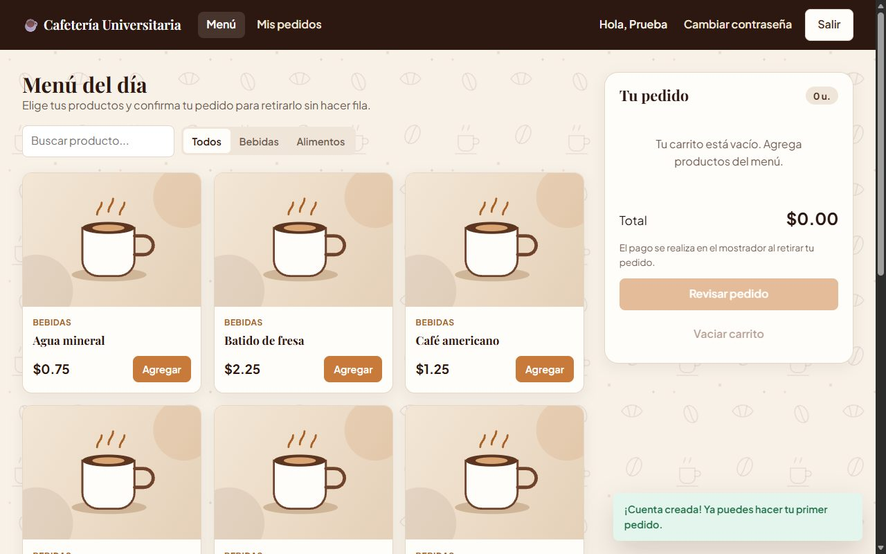
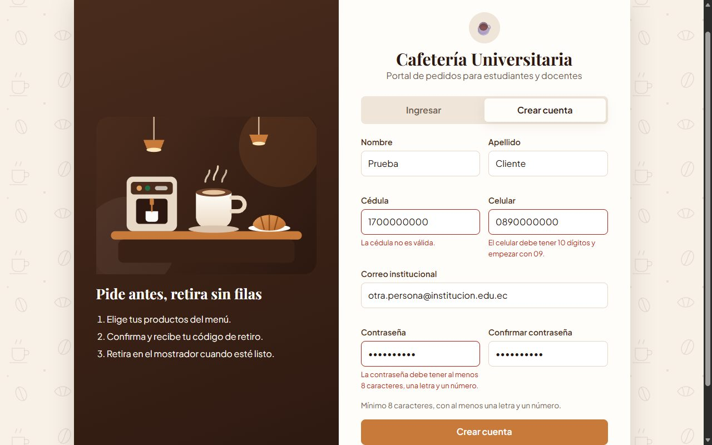
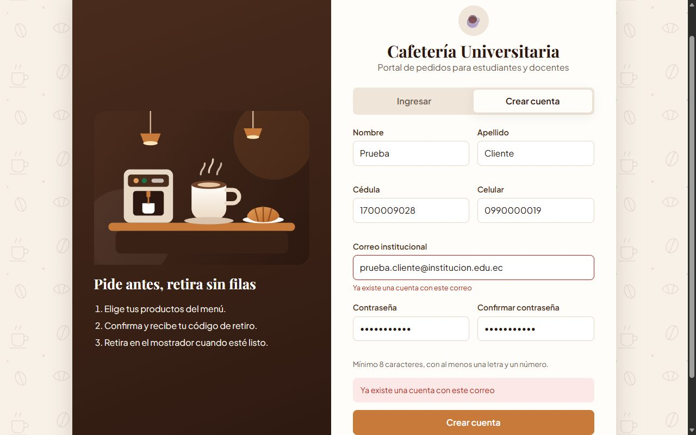
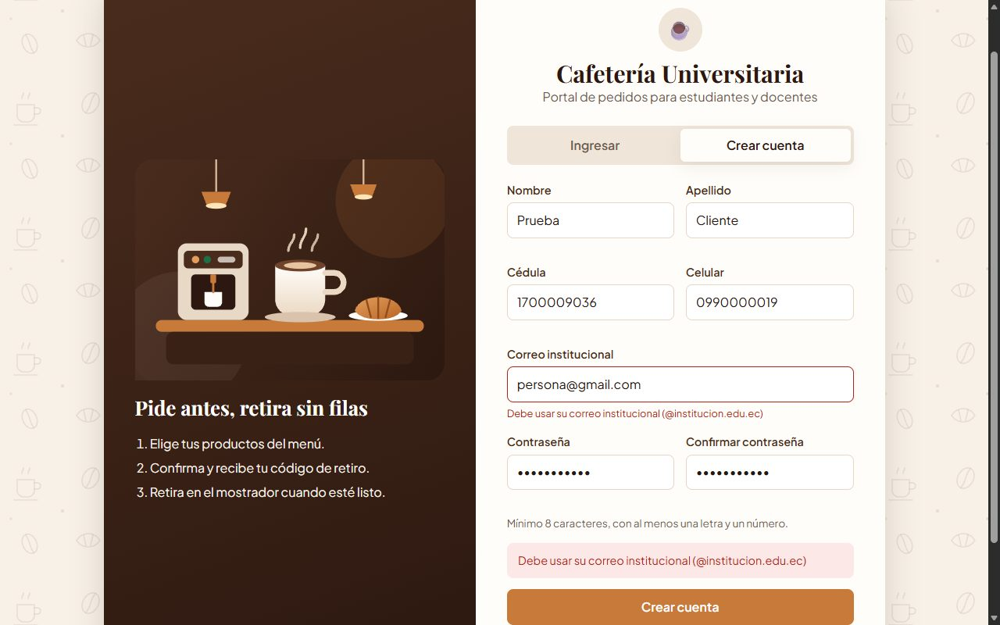
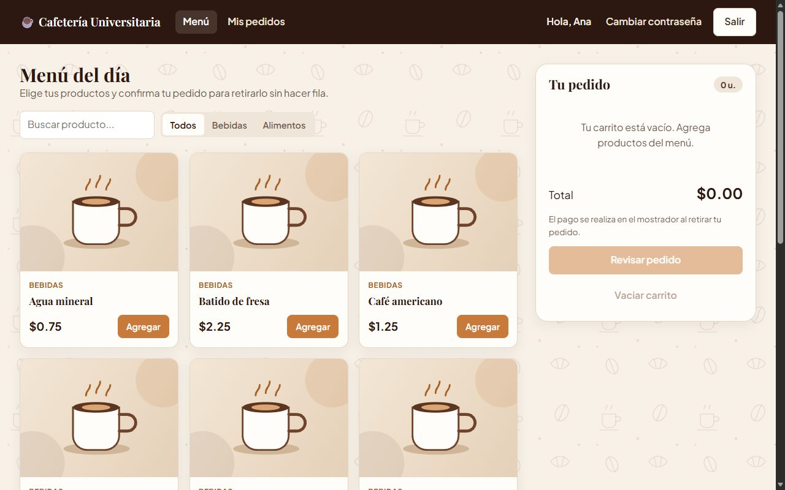
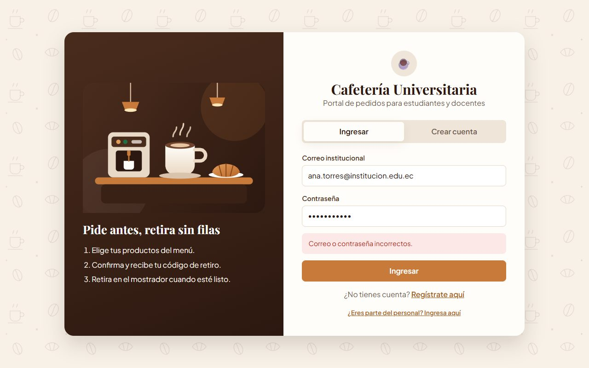
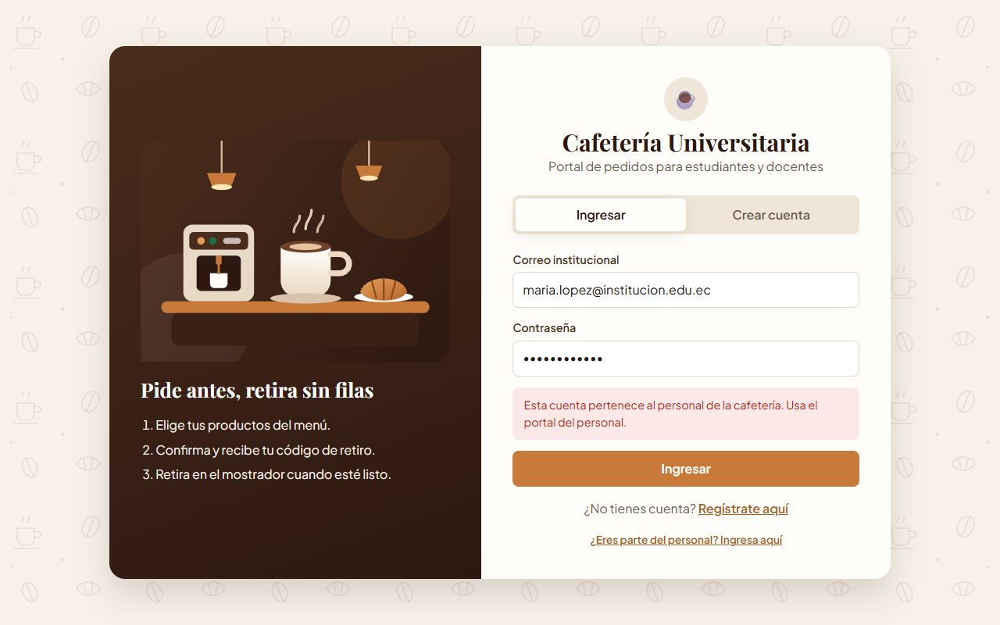
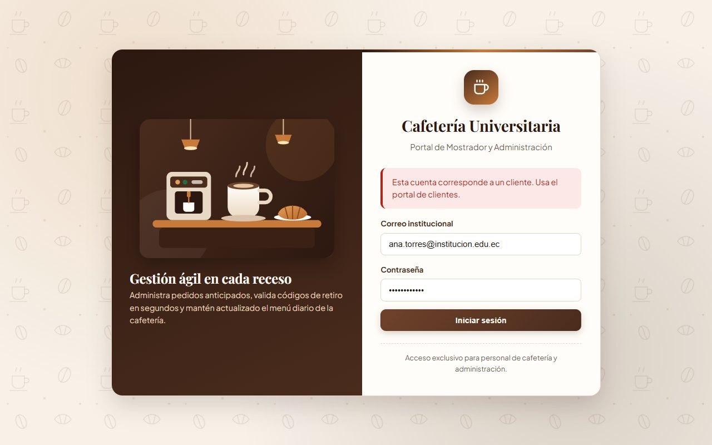
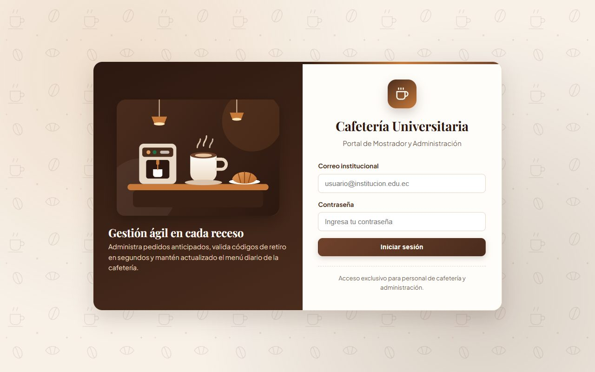

# Casos de prueba: registro y acceso

[← Índice](README.md)

## Registro

### CP-01

**Registrar un cliente con datos válidos**

| Campo | Detalle |
|---|---|
| Requisito | HU-CLI-07 |
| Precondición | No existe una cuenta con el correo ni la cédula usados. |
| Resultado esperado | Se crea la cuenta, se inicia sesión y se muestra el menú. |
| Resultado obtenido | Se abrió el menú con el aviso «¡Cuenta creada! Ya puedes hacer tu primer pedido.». |
| Estado | **Aprobado** |

**Pasos**

1. Abrir el portal de clientes y pulsar «Crear cuenta».
2. Completar todos los campos con datos válidos.
3. Pulsar «Crear cuenta».

**Captura del resultado**

### CP-02

**Registrar con datos no válidos**

| Campo | Detalle |
|---|---|
| Requisito | HU-CLI-07 |
| Precondición | Ninguna. |
| Resultado esperado | No se crea la cuenta y se indica el error de cada campo. |
| Resultado obtenido | No se creó la cuenta. Mensajes: La cédula no es válida. · El celular debe tener 10 dígitos y empezar con 09. · La contraseña debe tener al menos 8 caracteres, una letra y un número. |
| Estado | **Aprobado** |

**Pasos**

1. Abrir «Crear cuenta».
2. Escribir una cédula con dígito verificador incorrecto, un celular que empiece con 08 y una contraseña sin números.
3. Pulsar «Crear cuenta».

**Captura del resultado**

### CP-03

**Registrar un correo ya usado**

| Campo | Detalle |
|---|---|
| Requisito | HU-CLI-07 |
| Precondición | Existe la cuenta creada en CP-01. |
| Resultado esperado | No se crea la cuenta y se informa que el correo ya existe. |
| Resultado obtenido | Mensaje: Ya existe una cuenta con este correo |
| Estado | **Aprobado** |

**Pasos**

1. Abrir «Crear cuenta».
2. Usar el mismo correo de CP-01 con otra cédula.
3. Pulsar «Crear cuenta».

**Captura del resultado**

### CP-36

**Registrar un correo que no es institucional**

| Campo | Detalle |
|---|---|
| Requisito | HU-CLI-07 |
| Precondición | Ninguna. |
| Resultado esperado | No se crea la cuenta y se pide el correo institucional. |
| Resultado obtenido | No se creó la cuenta. Mensajes: Debe usar su correo institucional (@institucion.edu.ec) |
| Estado | **Aprobado** |

**Pasos**

1. Abrir «Crear cuenta».
2. Completar datos válidos, pero con un correo @gmail.com.
3. Pulsar «Crear cuenta».

**Captura del resultado**

## Acceso

### CP-04

**Iniciar sesión como cliente**

| Campo | Detalle |
|---|---|
| Requisito | HU-USU-02 |
| Precondición | Cuenta de cliente de prueba. |
| Resultado esperado | Se muestra el menú con el nombre del cliente. |
| Resultado obtenido | Menú abierto con el saludo «Hola, Ana». |
| Estado | **Aprobado** |

**Pasos**

1. Abrir el portal de clientes.
2. Escribir correo y contraseña correctos.
3. Pulsar «Ingresar».

**Captura del resultado**

### CP-05

**Iniciar sesión con contraseña incorrecta**

| Campo | Detalle |
|---|---|
| Requisito | HU-USU-02 |
| Precondición | Cuenta de cliente de prueba. |
| Resultado esperado | No se inicia sesión y el mensaje no revela si el correo existe. |
| Resultado obtenido | Mensaje: «Correo o contraseña incorrectos.» |
| Estado | **Aprobado** |

**Pasos**

1. Abrir el portal de clientes.
2. Escribir el correo correcto y una contraseña incorrecta.
3. Pulsar «Ingresar».

**Captura del resultado**

### CP-06

**Una cuenta del personal no entra al portal de clientes**

| Campo | Detalle |
|---|---|
| Requisito | HU-USU-02 |
| Precondición | Cuenta de trabajador de prueba. |
| Resultado esperado | Se rechaza el acceso y se indica usar el portal del personal. |
| Resultado obtenido | Mensaje: «Esta cuenta pertenece al personal de la cafetería. Usa el portal del personal.» |
| Estado | **Aprobado** |

**Pasos**

1. Abrir el portal de clientes.
2. Iniciar sesión con una cuenta de trabajador.

**Captura del resultado**

### CP-07

**Una cuenta de cliente no entra al portal del personal**

| Campo | Detalle |
|---|---|
| Requisito | HU-USU-02 |
| Precondición | Cuenta de cliente de prueba. |
| Resultado esperado | Se rechaza el acceso y se indica usar el portal de clientes. |
| Resultado obtenido | Mensaje: «Esta cuenta corresponde a un cliente. Usa el portal de clientes.» |
| Estado | **Aprobado** |

**Pasos**

1. Abrir el portal del personal.
2. Iniciar sesión con una cuenta de cliente.

**Captura del resultado**

### CP-08

**Abrir una página protegida sin sesión**

| Campo | Detalle |
|---|---|
| Requisito | HU-USU-02, RNF-02 |
| Precondición | No hay sesión iniciada. |
| Resultado esperado | El sistema redirige a la pantalla de acceso. |
| Resultado obtenido | Redirigió a /admin/index.html. |
| Estado | **Aprobado** |

**Pasos**

1. Escribir en el navegador la dirección del panel del trabajador (/admin/panel-trabajador.html).

**Captura del resultado**

