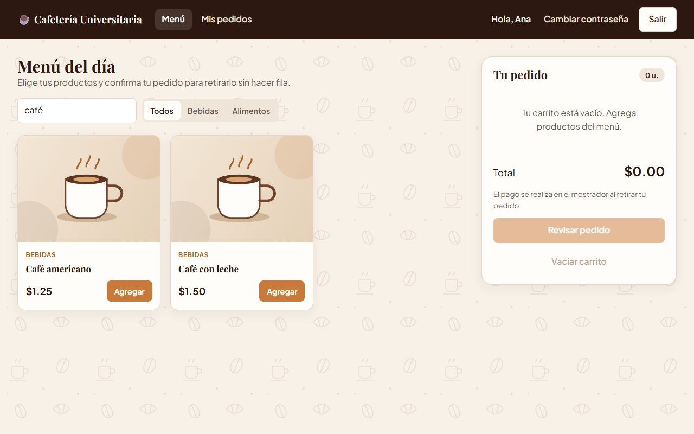
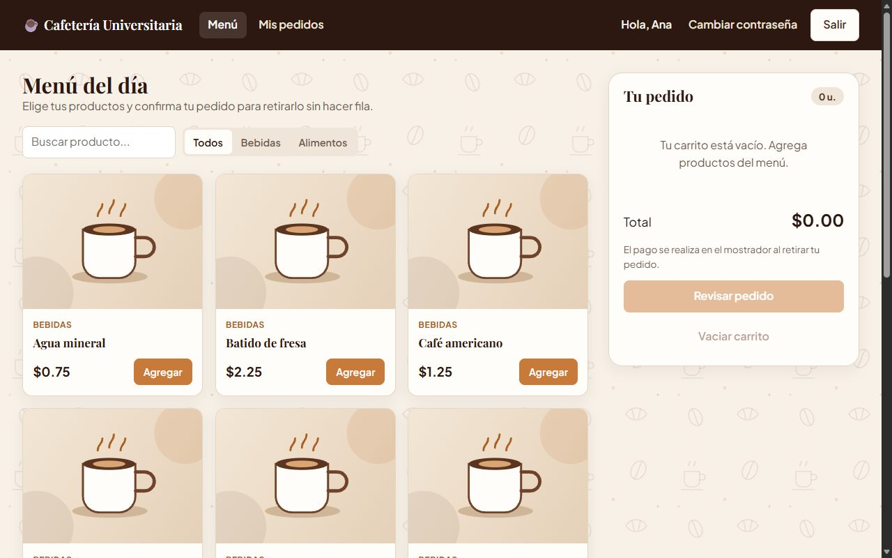
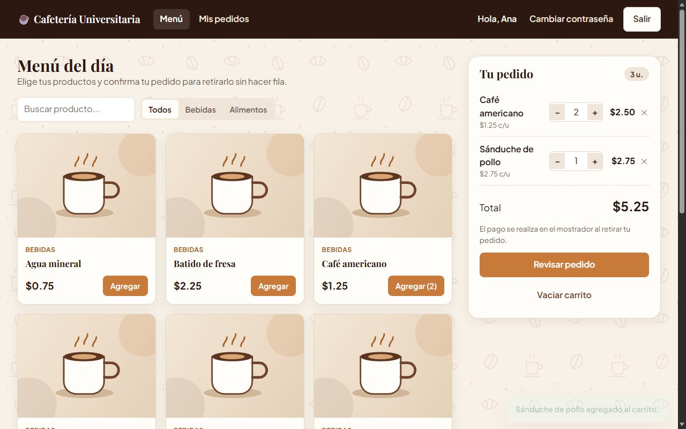
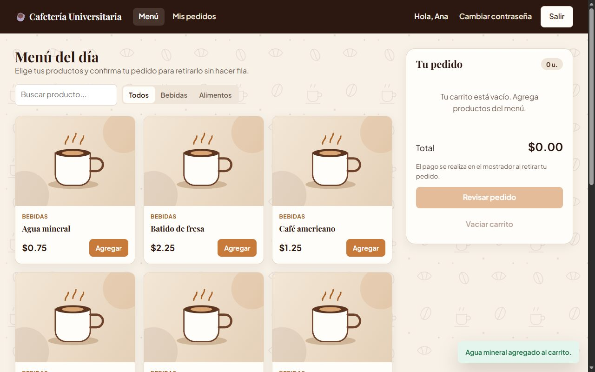
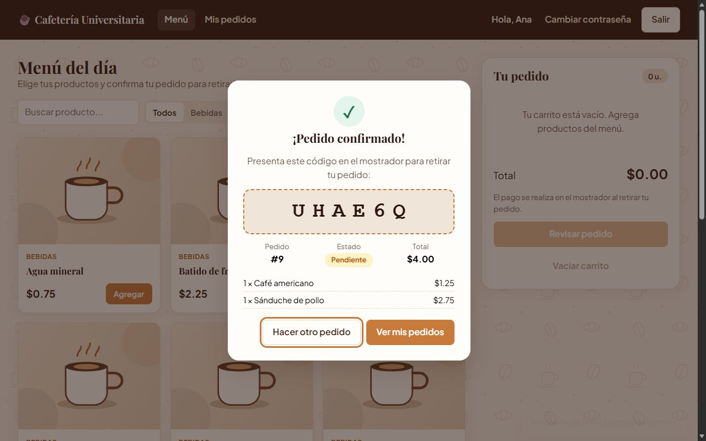
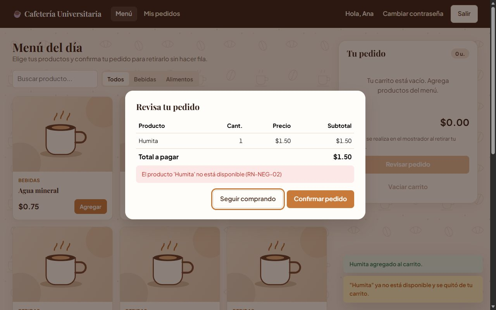
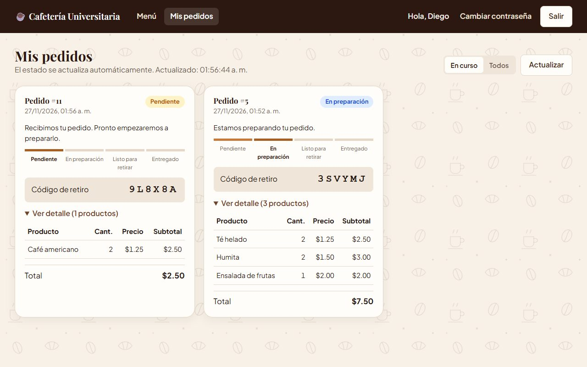
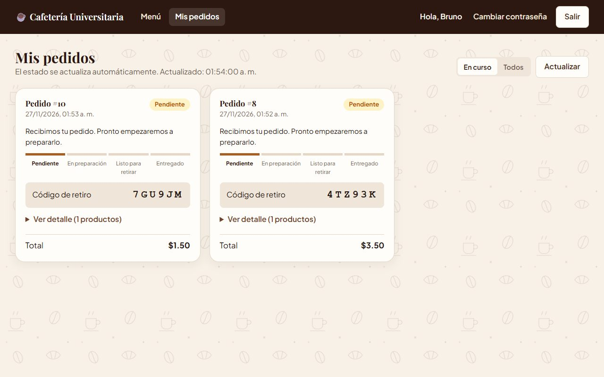
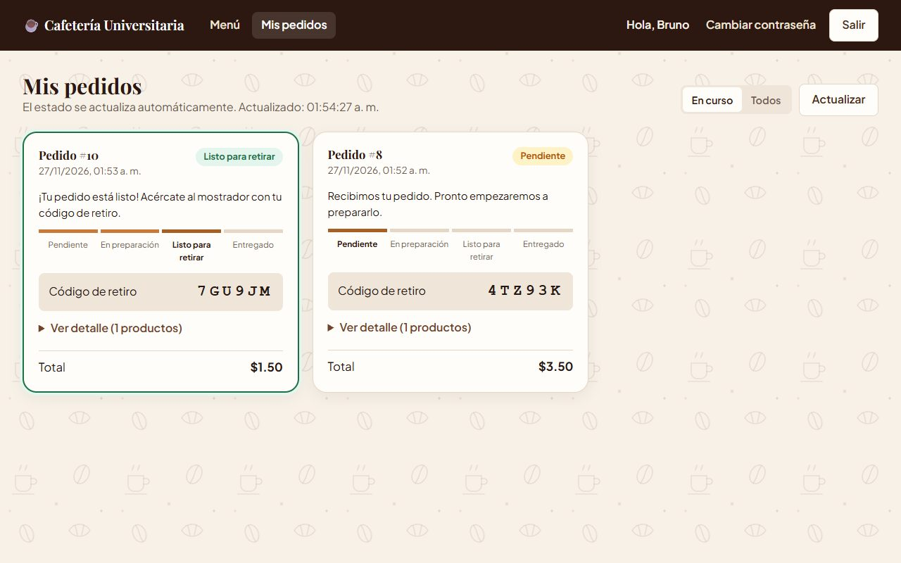

# Casos de prueba: menú, pedidos y seguimiento

[← Índice](README.md)

## Menú

### CP-09

**Consultar el menú y los precios**

| Campo | Detalle |
|---|---|
| Requisito | HU-CLI-01, RN-NEG-02 |
| Precondición | «Pastel de chocolate» está marcado como no disponible. |
| Resultado esperado | Se muestran solo los productos disponibles, cada uno con su precio. |
| Resultado obtenido | 11 productos mostrados (11 disponibles en la base); «Pastel de chocolate» no aparece. |
| Estado | **Aprobado** |

**Pasos**

1. Iniciar sesión como cliente.
2. Revisar los productos y precios del menú.

**Captura del resultado**

### CP-10

**Buscar y filtrar productos**

| Campo | Detalle |
|---|---|
| Requisito | HU-CLI-01 |
| Precondición | Sesión de cliente. |
| Resultado esperado | Solo se muestran los productos cuyo nombre contiene «café». |
| Resultado obtenido | Se mostraron: Café americano, Café con leche. |
| Estado | **Aprobado** |

**Pasos**

1. Escribir «café» en «Buscar producto».

**Captura del resultado**

## Pedido

### CP-11

**No se puede confirmar un pedido vacío**

| Campo | Detalle |
|---|---|
| Requisito | HU-CLI-04, RN-NEG-01 |
| Precondición | Sesión de cliente con el carrito vacío. |
| Resultado esperado | El botón está deshabilitado. |
| Resultado obtenido | «Revisar pedido» aparece deshabilitado. |
| Estado | **Aprobado** |

**Pasos**

1. Abrir el menú sin agregar productos.
2. Intentar pulsar «Revisar pedido».

**Captura del resultado**

### CP-12

**Armar un pedido y revisar el total**

| Campo | Detalle |
|---|---|
| Requisito | HU-CLI-02, HU-CLI-03, RN-NEG-03 |
| Precondición | Sesión de cliente. |
| Resultado esperado | El total es 2 × precio del café + precio del sánduche. |
| Resultado obtenido | Total mostrado $5.25; esperado $5.25. |
| Estado | **Aprobado** |

**Pasos**

1. Agregar dos veces «Café americano».
2. Agregar una vez «Sánduche de pollo».
3. Revisar el total en «Tu pedido».

**Captura del resultado**

### CP-13

**Quitar un producto reduciendo la cantidad a cero**

| Campo | Detalle |
|---|---|
| Requisito | HU-CLI-02, RN-NEG-01 |
| Precondición | Un producto en el carrito. |
| Resultado esperado | El carrito no admite la cantidad cero: el producto se quita. |
| Resultado obtenido | Líneas en el carrito: 0; total $0.00. |
| Estado | **Aprobado** |

**Pasos**

1. Agregar «Agua mineral».
2. Escribir 0 en el campo de cantidad.

**Captura del resultado**

### CP-14

**Confirmar el pedido y obtener el código**

| Campo | Detalle |
|---|---|
| Requisito | HU-CLI-05, RN-NEG-05, RN-NEG-06 |
| Precondición | Sesión de cliente. |
| Resultado esperado | Se muestra un código de retiro de 6 caracteres, el estado Pendiente y el total. |
| Resultado obtenido | Código UHAE6Q, estado Pendiente, total $4.00. |
| Estado | **Aprobado** |

**Pasos**

1. Agregar «Café americano» y «Sánduche de pollo».
2. Pulsar «Revisar pedido».
3. Pulsar «Confirmar pedido».

**Captura del resultado**

### CP-15

**Un producto deja de estar disponible antes de confirmar**

| Campo | Detalle |
|---|---|
| Requisito | HU-CLI-04, RN-NEG-02 |
| Precondición | El cliente tiene el producto en el carrito y el personal lo desactiva. |
| Resultado esperado | El pedido no se confirma y se informa el motivo. |
| Resultado obtenido | No se creó el pedido. Mensaje: El producto 'Humita' no está disponible (RN-NEG-02) Humita agregado al carrito. · "Humita" ya no está disponible y se quitó de tu carrito. |
| Estado | **Aprobado** |

**Pasos**

1. Agregar «Humita» y pulsar «Revisar pedido».
2. Mientras tanto, el trabajador marca «Humita» como no disponible.
3. Pulsar «Confirmar pedido».

**Captura del resultado**

### CP-35

**La API rechaza una cantidad decimal**

| Campo | Detalle |
|---|---|
| Requisito | RN-NEG-01, HU-CLI-04 |
| Precondición | Sesión de cliente. La interfaz no permite decimales, por lo que la petición se envía a la API. |
| Resultado esperado | La petición se rechaza (400) y no se crea ningún pedido. |
| Resultado obtenido | Respuesta 201; pedidos creados: 1; cantidad registrada: 2. |
| Estado | **Fallido** en la primera ejecución (ver el [análisis del fallo](07-Analisis-de-Fallos.md)) |

**Pasos**

1. Iniciar sesión como cliente.
2. Desde la consola del navegador enviar POST /api/pedidos con cantidad 2.9 de «Café americano».
3. Abrir «Mis pedidos».

**Captura del resultado**

## Seguimiento

### CP-16

**Consultar el estado de mis pedidos**

| Campo | Detalle |
|---|---|
| Requisito | HU-CLI-06, RU-05 |
| Precondición | El cliente tiene un pedido recién creado. |
| Resultado esperado | Se muestra cada pedido en curso con su estado, código de retiro y total. |
| Resultado obtenido | El pedido #10 aparece como Pendiente con su código. |
| Estado | **Aprobado** |

**Pasos**

1. Iniciar sesión como cliente.
2. Abrir «Mis pedidos».

**Captura del resultado**

### CP-20

**El cliente ve que su pedido está listo**

| Campo | Detalle |
|---|---|
| Requisito | HU-CLI-06 |
| Precondición | Pedido en estado Listo para retirar. |
| Resultado esperado | El pedido se muestra como Listo para retirar con la indicación de acercarse al mostrador. |
| Resultado obtenido | El pedido #10 indica que está listo para retirar. |
| Estado | **Aprobado** |

**Pasos**

1. Iniciar sesión como el cliente del pedido.
2. Abrir «Mis pedidos».

**Captura del resultado**

