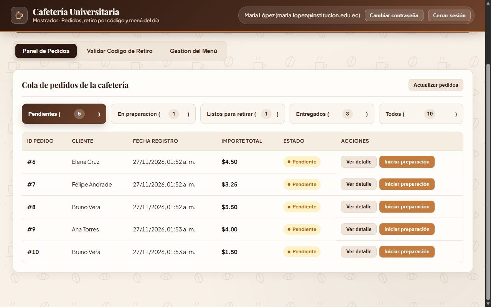
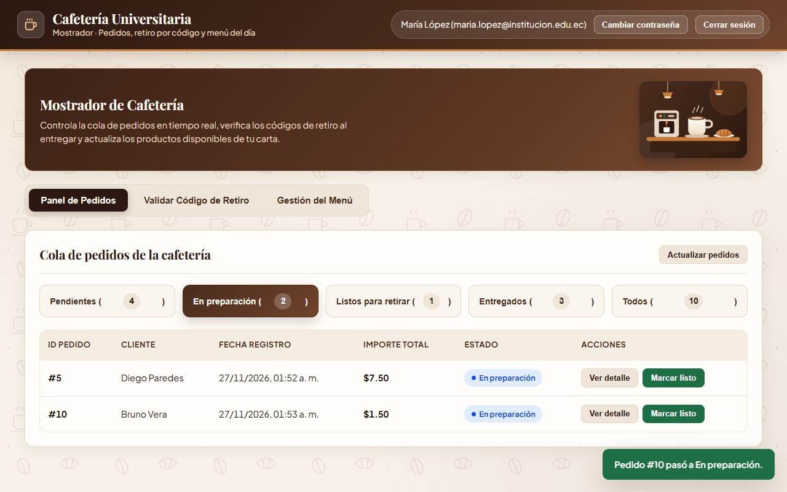
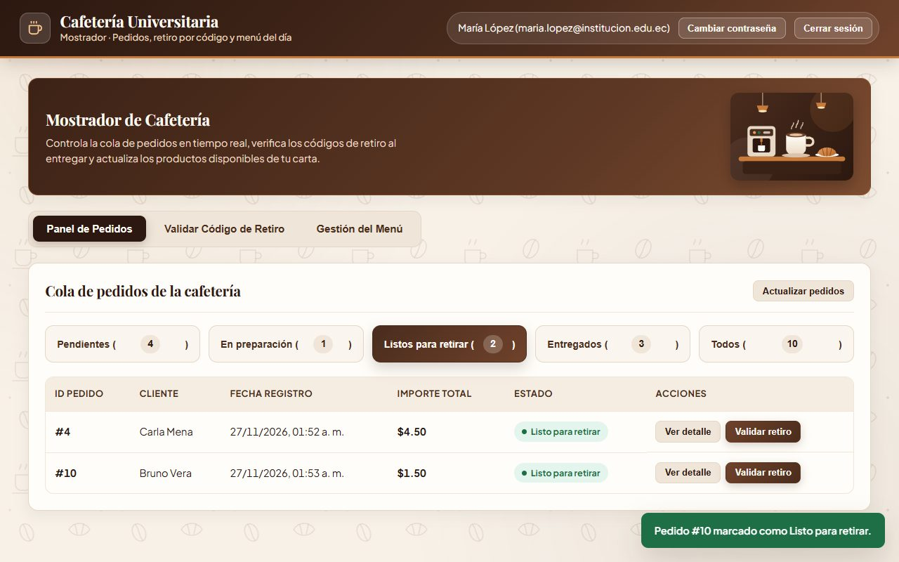
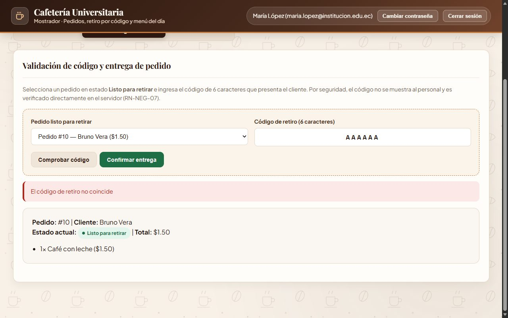
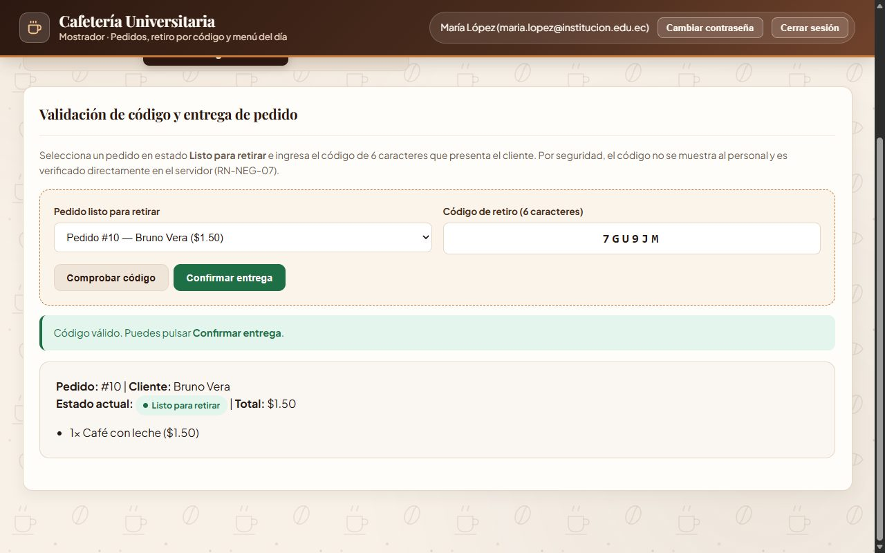
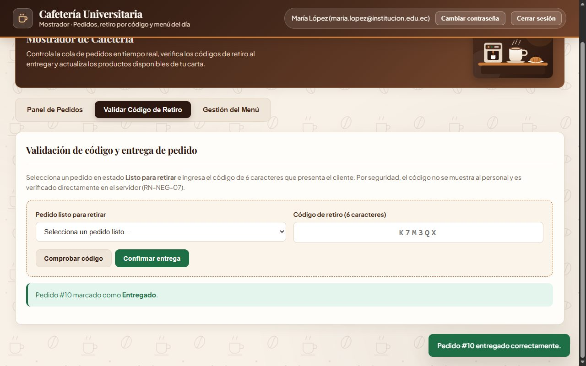

# Casos de prueba: atención y entrega

[← Índice](README.md)

## Atención

### CP-17

**Consultar los pedidos pendientes**

| Campo | Detalle |
|---|---|
| Requisito | HU-PER-04, RN-NEG-07 |
| Precondición | Sesión de trabajador y pedidos pendientes. |
| Resultado esperado | Se listan los pedidos pendientes y no se muestran sus códigos de retiro. |
| Resultado obtenido | 5 pedidos pendientes listados; ningún código visible. |
| Estado | **Aprobado** |

**Pasos**

1. Iniciar sesión como trabajador.
2. En «Panel de Pedidos» revisar el filtro «Pendientes».

**Captura del resultado**

### CP-18

**Iniciar la preparación**

| Campo | Detalle |
|---|---|
| Requisito | HU-PER-05, RN-NEG-06 |
| Precondición | Pedido de CP-16 en estado Pendiente. |
| Resultado esperado | El pedido pasa a En preparación. |
| Resultado obtenido | Estado en la base: en_preparacion. Aviso: «Pedido #10 pasó a En preparación.» |
| Estado | **Aprobado** |

**Pasos**

1. En «Pendientes», pulsar «Iniciar preparación» en el pedido.

**Captura del resultado**

### CP-19

**Marcar el pedido como listo**

| Campo | Detalle |
|---|---|
| Requisito | HU-PER-06, RN-NEG-06 |
| Precondición | Pedido en estado En preparación. |
| Resultado esperado | El pedido pasa a Listo para retirar. |
| Resultado obtenido | Estado en la base: listo. Aviso: «Pedido #10 marcado como Listo para retirar.» |
| Estado | **Aprobado** |

**Pasos**

1. Abrir el filtro «En preparación».
2. Pulsar «Marcar listo».

**Captura del resultado**

## Entrega

### CP-21

**Entregar con un código incorrecto**

| Campo | Detalle |
|---|---|
| Requisito | HU-PER-07, RN-NEG-07 |
| Precondición | Pedido en estado Listo para retirar. |
| Resultado esperado | No se registra la entrega y se informa que el código no coincide. |
| Resultado obtenido | Estado: listo. Mensaje: «El código de retiro no coincide Pedido: #10 · Cliente: Bruno Vera Estado actual: Listo par» |
| Estado | **Aprobado** |

**Pasos**

1. Abrir «Validar Código de Retiro» y elegir el pedido.
2. Escribir el código AAAAAA.
3. Pulsar «Confirmar entrega».

**Captura del resultado**

### CP-22

**Comprobar el código correcto**

| Campo | Detalle |
|---|---|
| Requisito | HU-PER-07, RN-NEG-07 |
| Precondición | Pedido en estado Listo para retirar. |
| Resultado esperado | Se indica que el código es válido y el estado no cambia. |
| Resultado obtenido | Estado: listo. Mensaje: «Código válido. Puedes pulsar Confirmar entrega. Pedido: #10 » |
| Estado | **Aprobado** |

**Pasos**

1. Elegir el pedido y escribir el código que presenta el cliente.
2. Pulsar «Comprobar código».

**Captura del resultado**

### CP-23

**Registrar la entrega con el código correcto**

| Campo | Detalle |
|---|---|
| Requisito | HU-PER-07, RN-NEG-06, RN-NEG-07 |
| Precondición | Pedido en estado Listo para retirar. |
| Resultado esperado | El pedido pasa a Entregado. |
| Resultado obtenido | Estado: entregado. Mensaje: «Pedido #10 marcado como Entregado.» |
| Estado | **Aprobado** |

**Pasos**

1. Elegir el pedido y escribir el código correcto.
2. Pulsar «Confirmar entrega».

**Captura del resultado**

