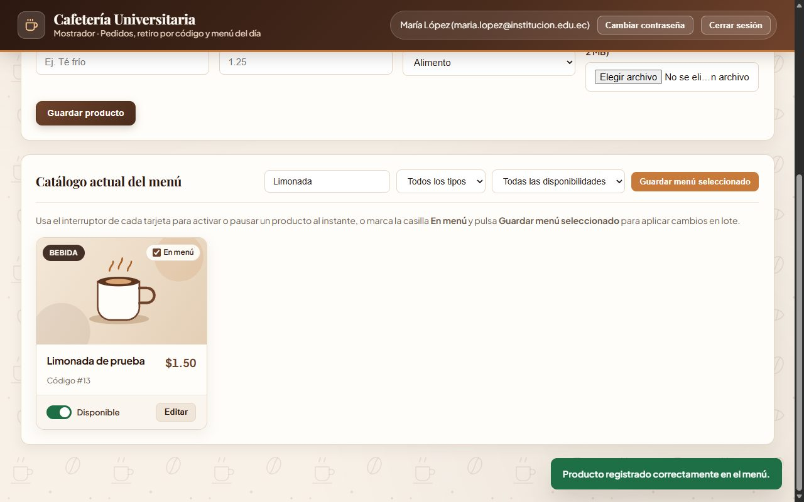
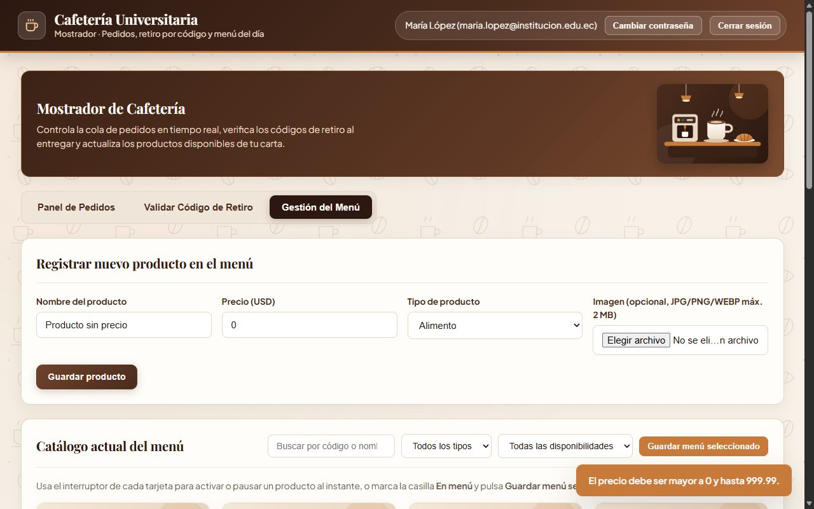
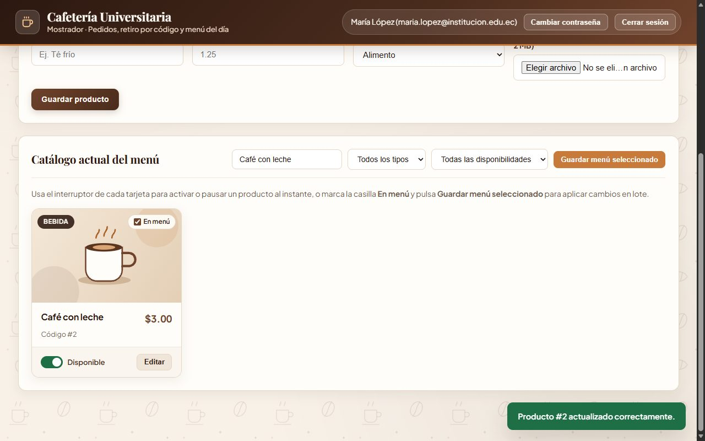
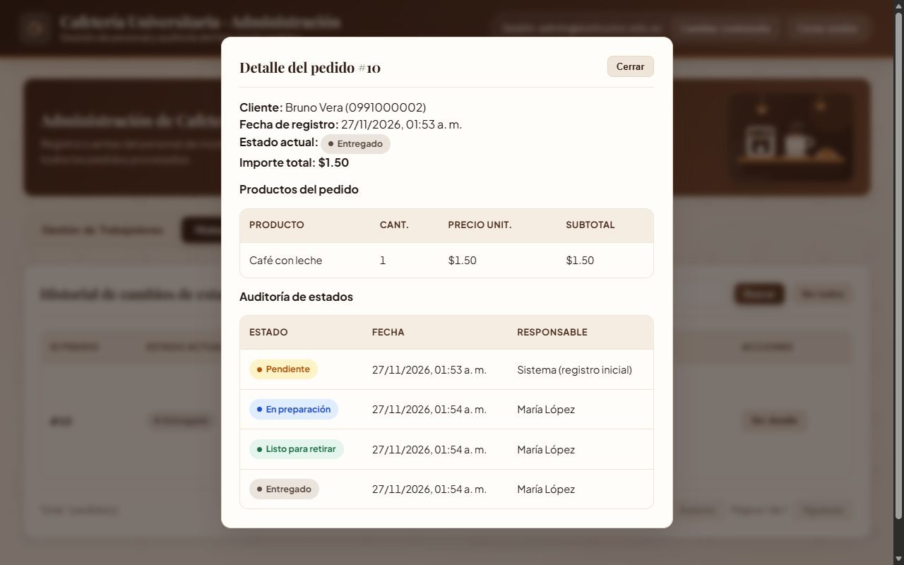
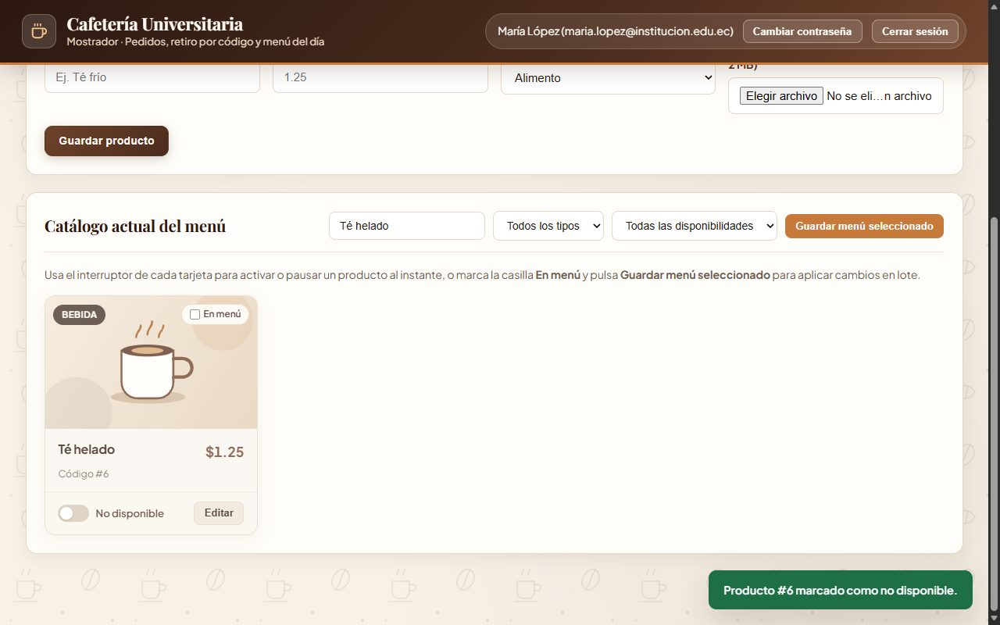
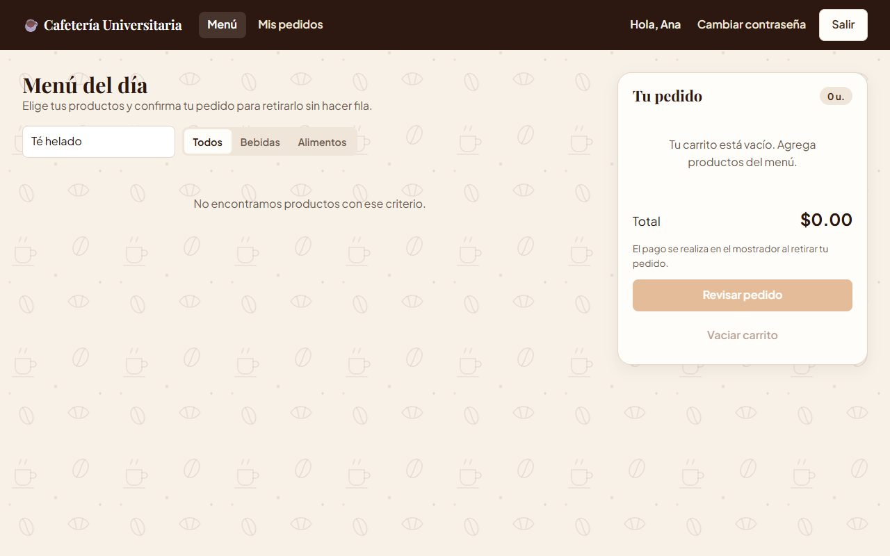
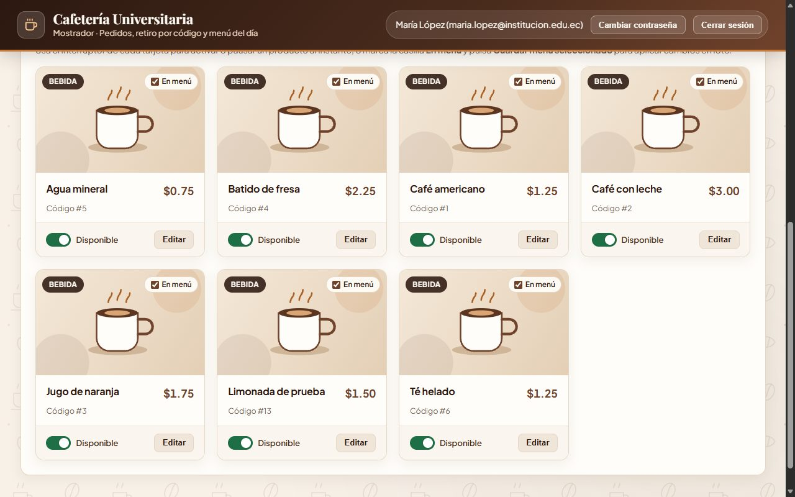
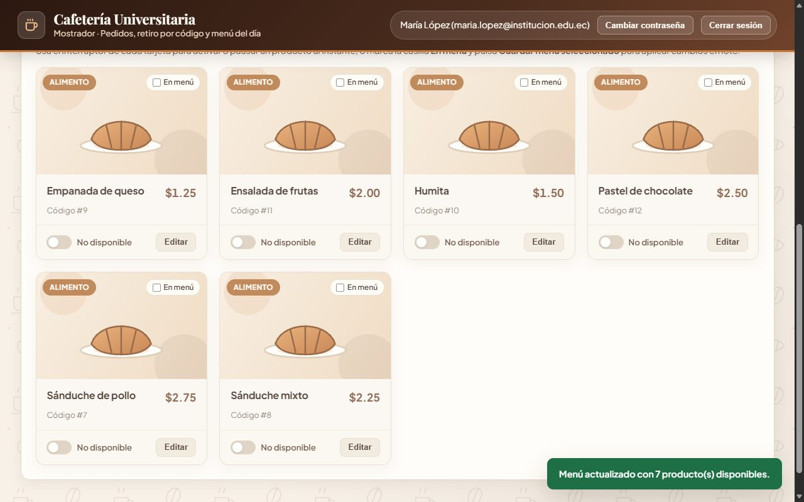

# Casos de prueba: productos

[← Índice](README.md)

## Productos

### CP-24

**Registrar un producto nuevo**

| Campo | Detalle |
|---|---|
| Requisito | HU-PER-01, RU-06 |
| Precondición | No existe un producto llamado «Limonada de prueba». |
| Resultado esperado | El producto se registra como disponible y aparece en el catálogo. |
| Resultado obtenido | Producto registrado y disponible. Aviso: «Producto registrado correctamente en el menú.» |
| Estado | **Aprobado** |

**Pasos**

1. Abrir «Gestión del Menú».
2. Escribir nombre «Limonada de prueba», precio 1.50 y tipo Bebida.
3. Pulsar «Guardar producto».

**Captura del resultado**

### CP-25

**Registrar un producto con precio no válido**

| Campo | Detalle |
|---|---|
| Requisito | HU-PER-01 |
| Precondición | Sesión de trabajador. |
| Resultado esperado | No se registra el producto y se informa el motivo. |
| Resultado obtenido | No se registró. Mensaje: «El precio debe ser mayor a 0 y hasta 999.99.» |
| Estado | **Aprobado** |

**Pasos**

1. En «Gestión del Menú», escribir un nombre y el precio 0.
2. Pulsar «Guardar producto».

**Captura del resultado**

### CP-26

**Cambiar el precio sin alterar pedidos anteriores**

| Campo | Detalle |
|---|---|
| Requisito | HU-PER-02, RN-NEG-04 |
| Precondición | Existe el pedido entregado de CP-23. |
| Resultado esperado | El catálogo muestra $3.00 y el pedido anterior conserva el precio con el que se confirmó. |
| Resultado obtenido | Catálogo: $3.00. El pedido #10 conserva $1.50. |
| Estado | **Aprobado** |

**Pasos**

1. Editar «Café con leche», escribir el precio 3.00 y guardar.
2. Iniciar sesión como administrador y abrir el detalle del pedido anterior en el historial.

**Captura del resultado**

### CP-27

**Desactivar un producto**

| Campo | Detalle |
|---|---|
| Requisito | HU-PER-03, RN-NEG-02 |
| Precondición | «Té helado» está disponible. |
| Resultado esperado | El producto queda como No disponible y no aparece al cliente. |
| Resultado obtenido | Disponible en la base: no; visible para el cliente: no. |
| Estado | **Aprobado** |

**Pasos**

1. En «Gestión del Menú», apagar el interruptor de «Té helado».
2. Iniciar sesión como cliente y buscar el producto.

**Captura del resultado**

### CP-28

**Guardar el menú en lote con un filtro activo**

| Campo | Detalle |
|---|---|
| Requisito | HU-PER-03, RN-NEG-02 |
| Precondición | Hay bebidas y alimentos disponibles. |
| Resultado esperado | Los alimentos, ocultos al guardar, conservan su disponibilidad. |
| Resultado obtenido | Alimentos disponibles antes de guardar: 5; después: 0. |
| Estado | **Fallido** en la primera ejecución (ver el [análisis del fallo](07-Analisis-de-Fallos.md)) |

**Pasos**

1. En «Gestión del Menú», elegir el filtro «Bebidas» sin cambiar ninguna casilla.
2. Pulsar «Guardar menú seleccionado».
3. Cambiar el filtro a «Alimentos» y revisar su disponibilidad.

**Captura del resultado**

