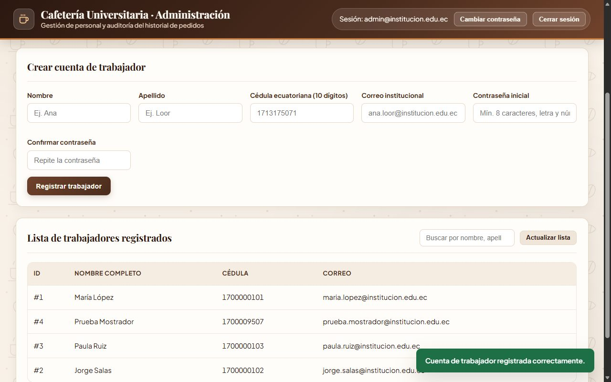
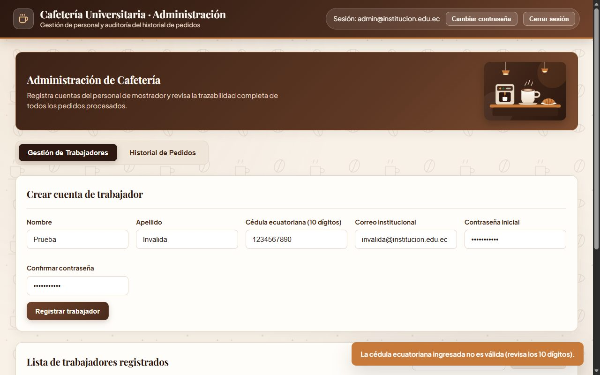
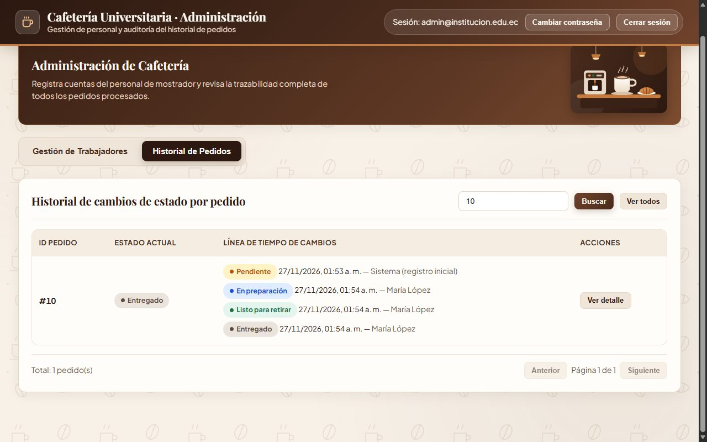
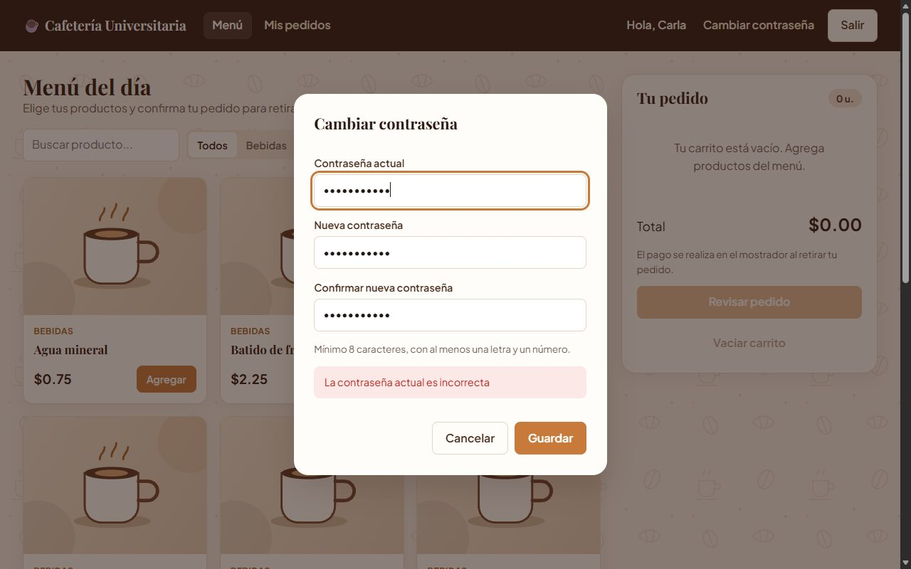
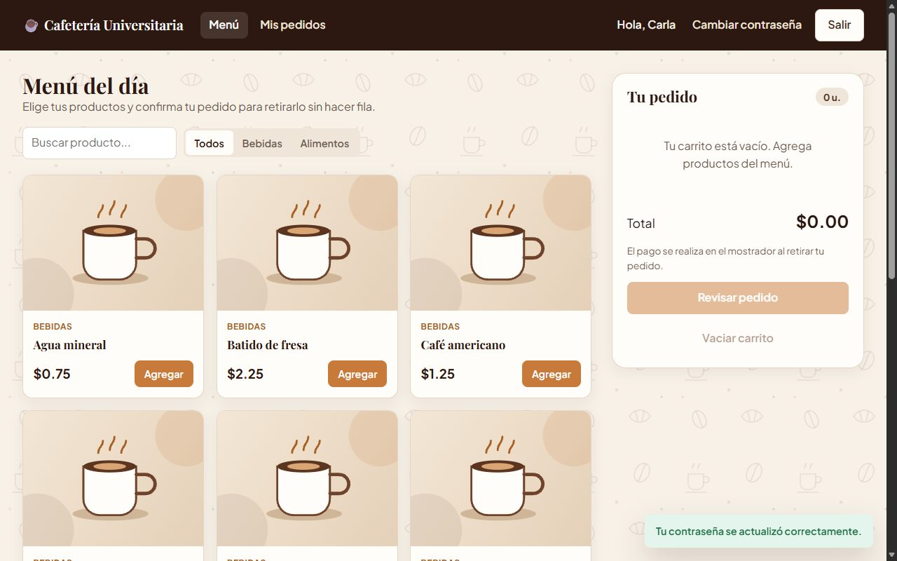
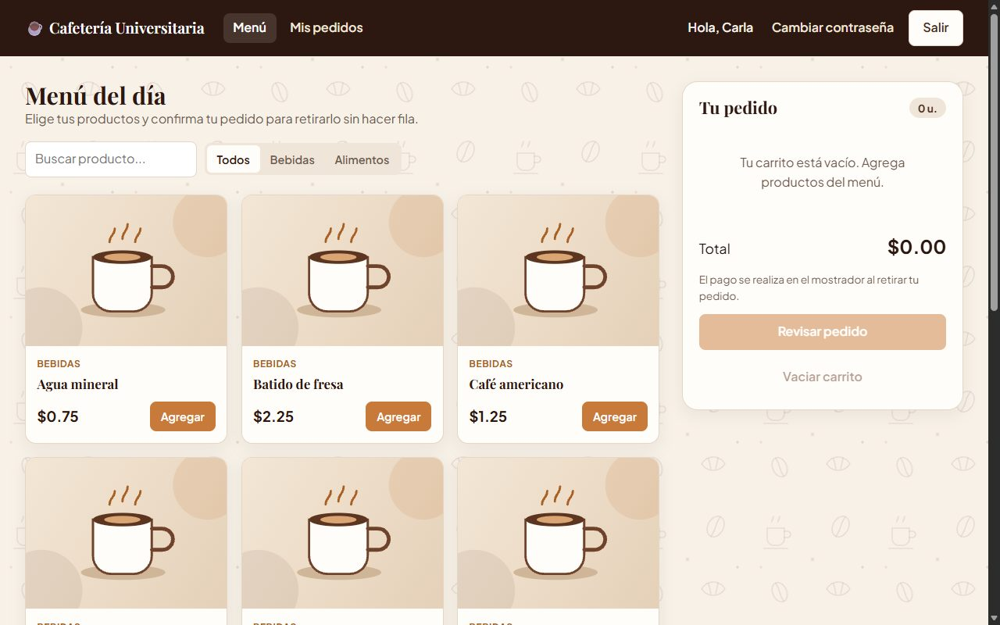
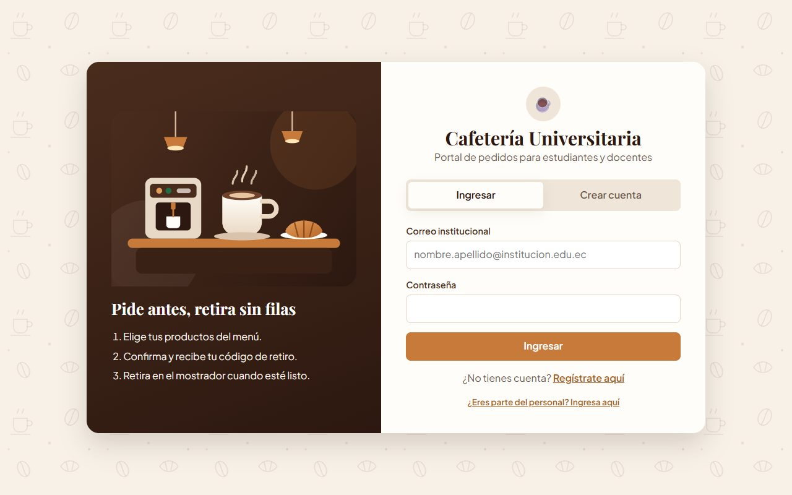
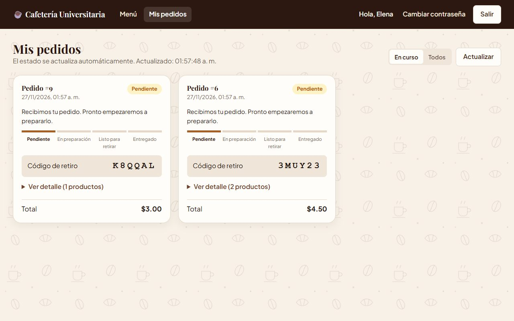

# Casos de prueba: administración, cuenta y persistencia

[← Índice](README.md)

## Administración

### CP-29

**Crear una cuenta de trabajador**

| Campo | Detalle |
|---|---|
| Requisito | HU-ADM-01, HU-ADM-02 |
| Precondición | Sesión de administrador; el correo y la cédula no existen. |
| Resultado esperado | La cuenta se crea y aparece en la lista, sin mostrar contraseñas. |
| Resultado obtenido | La cuenta aparece en la lista. Aviso: «Cuenta de trabajador registrada correctamente.» |
| Estado | **Aprobado** |

**Pasos**

1. Iniciar sesión como administrador.
2. Completar el formulario «Crear cuenta de trabajador» y pulsar «Registrar trabajador».
3. Revisar la lista de trabajadores.

**Captura del resultado**

### CP-30

**Crear un trabajador con cédula no válida**

| Campo | Detalle |
|---|---|
| Requisito | HU-ADM-01 |
| Precondición | Sesión de administrador. |
| Resultado esperado | No se crea la cuenta y se informa el error. |
| Resultado obtenido | No se creó. Mensaje: «La cédula ecuatoriana ingresada no es válida (revisa los 10 dígitos).» |
| Estado | **Aprobado** |

**Pasos**

1. Completar el formulario con la cédula 1234567890.
2. Pulsar «Registrar trabajador».

**Captura del resultado**

### CP-31

**Consultar el historial de un pedido**

| Campo | Detalle |
|---|---|
| Requisito | HU-ADM-03, RN-NEG-06 |
| Precondición | Existe el pedido entregado de CP-23. |
| Resultado esperado | Se muestran los cuatro estados en orden, con fecha y responsable. |
| Resultado obtenido | Aparecen Pendiente, En preparación, Listo para retirar y Entregado, con María López como responsable. |
| Estado | **Aprobado** |

**Pasos**

1. Abrir «Historial de Pedidos».
2. Escribir el número del pedido y pulsar «Buscar».

**Captura del resultado**

## Cuenta

### CP-32

**Cambiar contraseña indicando mal la actual**

| Campo | Detalle |
|---|---|
| Requisito | HU-USU-01 |
| Precondición | Sesión de cliente. |
| Resultado esperado | No se cambia la contraseña y se informa el error. |
| Resultado obtenido | Mensaje: «La contraseña actual es incorrecta» |
| Estado | **Aprobado** |

**Pasos**

1. Pulsar «Cambiar contraseña».
2. Escribir una contraseña actual incorrecta y una nueva válida.
3. Pulsar «Guardar».

**Captura del resultado**

### CP-33

**Cambiar la contraseña e iniciar sesión con la nueva**

| Campo | Detalle |
|---|---|
| Requisito | HU-USU-01 |
| Precondición | Sesión de cliente. |
| Resultado esperado | El cambio se acepta y la nueva contraseña permite ingresar. |
| Resultado obtenido | Se aceptó el cambio y el inicio de sesión con la nueva contraseña abrió el menú. |
| Estado | **Aprobado** |

**Pasos**

1. Cambiar la contraseña con los datos correctos.
2. Pulsar «Salir».
3. Iniciar sesión con la nueva contraseña.

**Captura del resultado**

### CP-34

**Cerrar sesión**

| Campo | Detalle |
|---|---|
| Requisito | HU-USU-02 |
| Precondición | Sesión de cliente. |
| Resultado esperado | Se vuelve a la pantalla de acceso y no se puede entrar sin iniciar sesión. |
| Resultado obtenido | Al abrir el menú se redirigió a /cliente/index.html. |
| Estado | **Aprobado** |

**Pasos**

1. Pulsar «Salir».
2. Intentar abrir de nuevo la página del menú.

**Captura del resultado**

## Persistencia

### CP-37

**Los pedidos se conservan al reiniciar la aplicación**

| Campo | Detalle |
|---|---|
| Requisito | RNF-01 |
| Precondición | Un cliente tiene un pedido registrado. |
| Resultado esperado | El pedido sigue registrado con el mismo número, código y total. |
| Resultado obtenido | Pedido #9 con código K8QQAL antes del reinicio. Pedido #9 con código K8QQAL después del reinicio. |
| Estado | **Aprobado** |

**Pasos**

1. Crear un pedido y abrir «Mis pedidos».
2. Detener la aplicación y volver a iniciarla.
3. Iniciar sesión y abrir «Mis pedidos».

**Captura del resultado**

