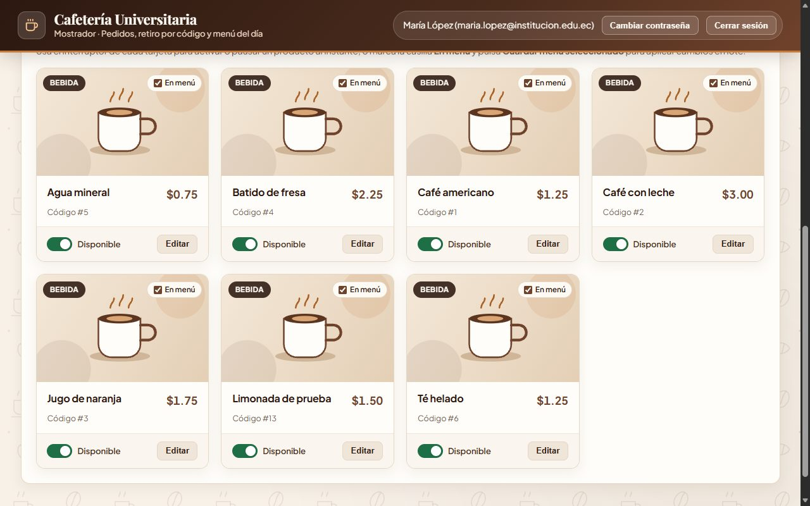
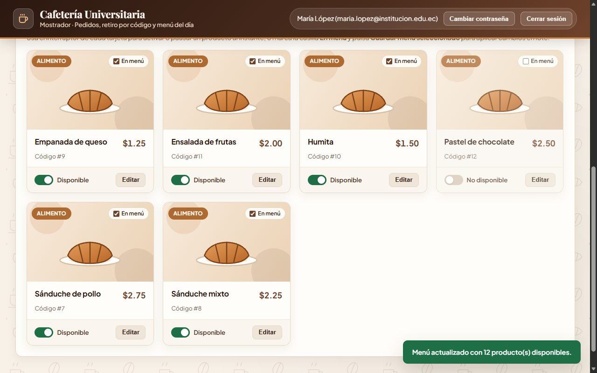
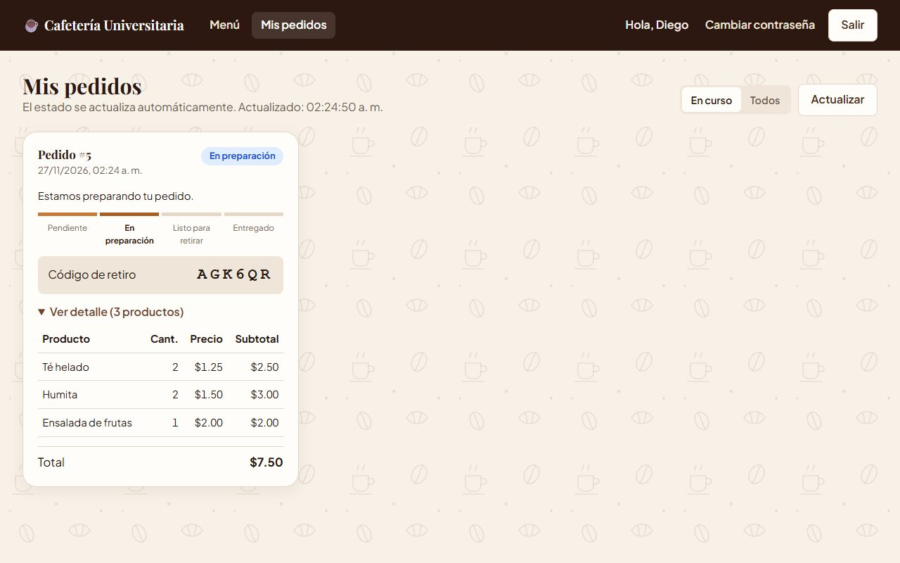

# Análisis, solución y nueva ejecución de los casos fallidos

[← Índice](README.md)

## CP-28: guardar el menú con un filtro activo

**Primera ejecución** (versión anterior a la corrección, commit `968afb7`): Alimentos disponibles antes de guardar: 5; después: 0. Capturas en [CP-28](05-Productos.md#cp-28). Para ejecutarla se sirvió en la aplicación el archivo `trabajador.js` de ese commit, el único que cambió después.

**Análisis.** Cada filtro volvía a dibujar el catálogo solo con los productos coincidentes. Al guardar, la pantalla recogía únicamente las casillas existentes y el servidor, que deja disponibles solo los códigos recibidos, desactivaba los demás. El defecto se detectó al revisar el código y se reprodujo con este caso.

**Solución** (commit `f5e1910`, `admin/js/pages/trabajador.js`): se dibujan todos los productos y los filtros solo ocultan tarjetas; además se conservan las casillas sin guardar al recargar el catálogo.

**Nueva ejecución** (commit `aa1507f`): **Aprobado.** Alimentos disponibles antes de guardar: 5; después: 5.





## CP-35: cantidad decimal en un pedido

**Primera ejecución** (commit `aa1507f`): Respuesta 201; pedidos creados: 1; cantidad registrada: 2.

Petición enviada:

```json
{ "items": [ { "codigoProducto": 1, "cantidad": 2.9 } ] }
```

Se esperaba el código 400. El servidor respondió 201 y registró 2 unidades, incumpliendo RN-NEG-01 (la cantidad debe ser un entero positivo).

**Análisis.** El convertidor de JSON (Jackson) acepta por defecto un decimal en un campo entero y descarta la parte decimal. `ValidadorPedido` recibe ya el número 2 y no puede detectar el error. La interfaz no envía decimales, por lo que el fallo solo se produce con peticiones directas a la API.

**Solución** (commit `d01f757`, integrado en `develop` con el Pull Request 29 y en `main` con el 30), en `cafeteria/src/main/resources/application.properties`:

```properties
# Rechaza decimales en campos enteros en vez de truncarlos (RN-NEG-01)
spring.jackson.deserialization.accept-float-as-int=false
```

El ajuste se aplica a todos los campos enteros que recibe la API. El mensaje de rechazo es el genérico «El cuerpo de la petición no es un JSON válido»; podría detallarse más adelante.

**Nueva ejecución** (commit `2a7f6bd` de `main`, con la solución integrada): **Aprobado.** Respuesta 400; pedidos creados: 0. También se repitió el anexo A: 56 de 56 aprobados.


