# Manual de Usuario

**Sistema:** Gestión de pedidos de una cafetería universitaria
**Versión:** Release 1.0

---

## Contenido

1. [Introducción](#1-introducción)
2. [Antes de empezar](#2-antes-de-empezar)
3. [Cliente](#3-cliente)
4. [Personal de cafetería (trabajador)](#4-personal-de-cafetería-trabajador)
5. [Administrador](#5-administrador)
6. [Cambiar la contraseña y cerrar sesión](#6-cambiar-la-contraseña-y-cerrar-sesión)
7. [Problemas frecuentes](#7-problemas-frecuentes)
8. [Relación con las historias de usuario](#8-relación-con-las-historias-de-usuario)

---

## 1. Introducción

El sistema permite pedir productos de la cafetería con anticipación y retirarlos en el mostrador con un código, sin hacer fila para ordenar.

| Tipo de usuario | Qué puede hacer |
|---|---|
| **Cliente** (estudiante o docente) | Crear su cuenta, ver el menú, hacer pedidos y consultar su estado. |
| **Trabajador** | Atender los pedidos, entregarlos con el código de retiro y gestionar el menú. |
| **Administrador** | Crear cuentas de trabajadores y consultar el historial de pedidos. |

Cada pedido avanza siempre en este orden:

**Pendiente → En preparación → Listo para retirar → Entregado**

El sistema no cobra en línea: **el pago se realiza en el mostrador al retirar el pedido**. Tampoco envía notificaciones por correo o mensaje, ni permite programar pedidos para una fecha posterior.

---

## 2. Antes de empezar

Necesitas un navegador web actualizado y acceso al sistema. En una instalación local, las direcciones son:

| Portal | Dirección |
|---|---|
| Clientes | `http://localhost:8080/cliente/` |
| Personal y administración | `http://localhost:8080/admin/` |

Si la cafetería publica el sistema en otra dirección, usa la que te indiquen.

- Se ingresa con el **correo institucional** (`@institucion.edu.ec`) y la contraseña.
- La contraseña debe tener **al menos 8 caracteres, con una letra y un número**.
- La sesión se cierra sola tras **8 horas** sin actividad. En un equipo compartido, cierra la sesión al terminar.

> Las capturas de este manual se tomaron con cuentas y datos de prueba. Los productos, precios y pedidos que veas pueden ser distintos.

---

## 3. Cliente

### 3.1 Crear una cuenta

1. En el portal de clientes, pulsa **Crear cuenta**.
2. Completa todos los campos:

   | Campo | Qué escribir |
   |---|---|
   | Nombre y Apellido | Solo letras, de 2 a 50 caracteres cada uno |
   | Cédula | Cédula ecuatoriana válida de 10 dígitos |
   | Celular | 10 dígitos, empezando con `09` |
   | Correo institucional | Tu correo `@institucion.edu.ec` |
   | Contraseña y Confirmar contraseña | Mínimo 8 caracteres, con una letra y un número |

3. Pulsa **Crear cuenta**.

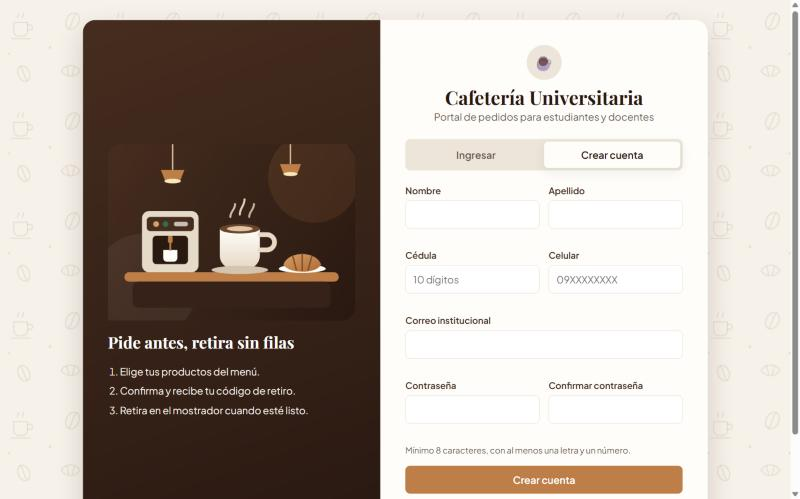

**Resultado:** entras directamente al menú con el aviso «¡Cuenta creada! Ya puedes hacer tu primer pedido».

Si un dato no es válido, el sistema muestra el motivo debajo del campo. No se admiten dos cuentas con el mismo correo o la misma cédula.

### 3.2 Iniciar sesión

1. En la pestaña **Ingresar**, escribe tu correo institucional y tu contraseña.
2. Pulsa **Ingresar**.

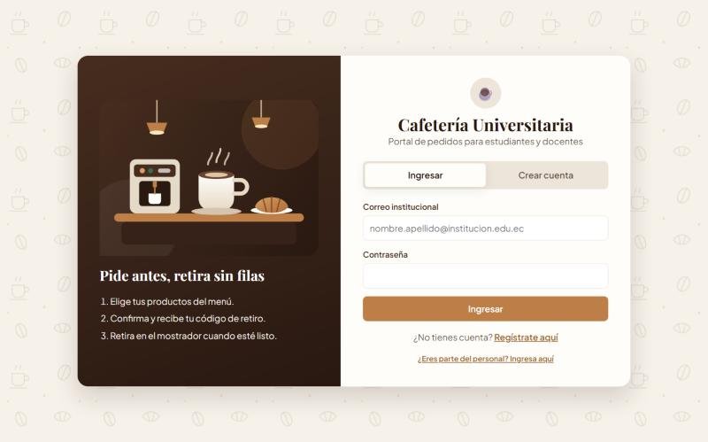

**Resultado:** se abre el menú del día.

### 3.3 Consultar el menú

El menú muestra los productos disponibles con su precio.

- Escribe en **Buscar producto...** para encontrar uno por su nombre.
- Usa **Todos**, **Bebidas** o **Alimentos** para filtrar.

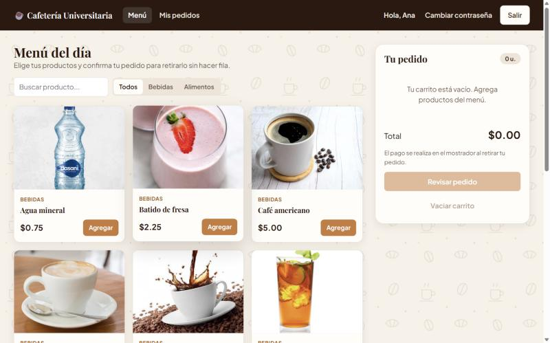

Si un producto no aparece, no está disponible en ese momento.

### 3.4 Armar el pedido

1. Pulsa **Agregar** en cada producto que quieras.
2. En el panel **Tu pedido**, ajusta las cantidades con **−** y **+**.
3. Para quitar un producto, pulsa **×**. Para empezar de nuevo, pulsa **Vaciar carrito**.
4. Comprueba el total.

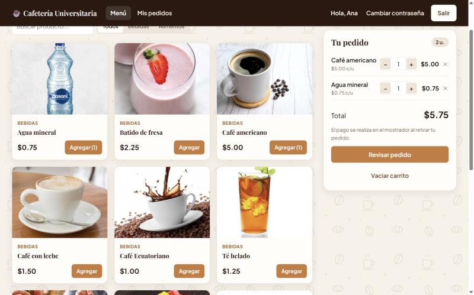

Un pedido admite hasta **30 productos distintos**. La cafetería puede además limitar las unidades de cada producto.

### 3.5 Confirmar el pedido y recibir el código

**Antes:** tener al menos un producto en **Tu pedido**.

1. Pulsa **Revisar pedido**.
2. Revisa productos, cantidades, precios y **Total a pagar**.
3. Pulsa **Confirmar pedido**. Si quieres cambiar algo, pulsa **Seguir comprando**.

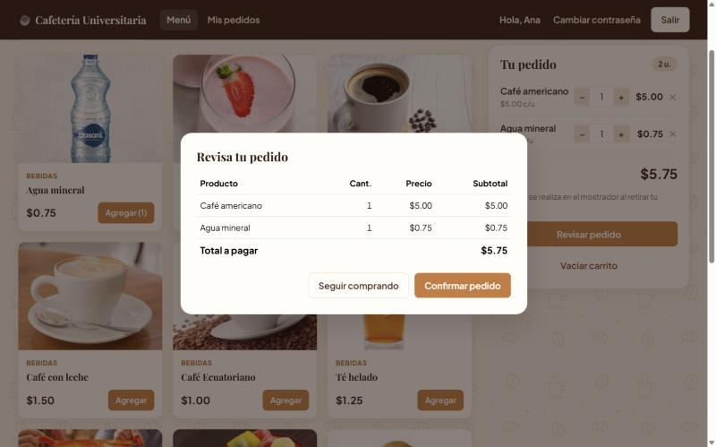

**Resultado:** aparece **¡Pedido confirmado!** con tu **código de retiro** de 6 caracteres, el número de pedido, el estado y el total.

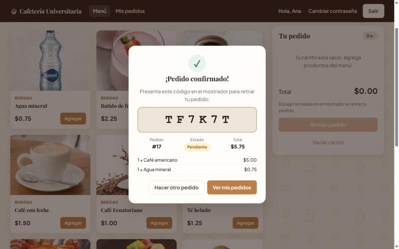

Pulsa **Ver mis pedidos** para seguir su avance o **Hacer otro pedido** para volver al menú.

> **Importante:** revisa bien antes de confirmar. La aplicación no tiene opción para modificar ni cancelar un pedido confirmado. El código es lo que permite retirarlo: no lo compartas.

Si un producto deja de estar disponible antes de confirmar, el sistema te avisa y actualiza tu pedido. También te avisa si cambia un precio.

### 3.6 Consultar el estado de tus pedidos

1. Pulsa **Mis pedidos** en la parte superior.
2. Elige **En curso** (pedidos sin entregar) o **Todos**.
3. Abre **Ver detalle** para ver los productos de un pedido.

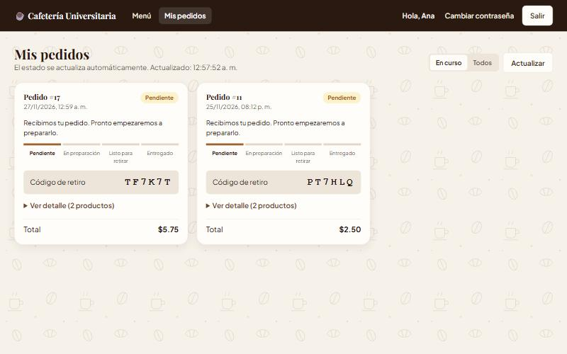

| Estado | Qué significa |
|---|---|
| Pendiente | La cafetería recibió tu pedido. |
| En preparación | Lo están preparando. |
| Listo para retirar | Acércate al mostrador con tu código. |
| Entregado | Ya lo retiraste. Aparece en **Todos**. |

La página se actualiza sola cada 15 segundos y te avisa cuando un pedido pasa a **Listo para retirar**. También puedes pulsar **Actualizar**.

### 3.7 Retirar el pedido

1. Espera el estado **Listo para retirar**.
2. En el mostrador, muestra o dicta tu **código de retiro**.
3. Paga y recibe tu pedido.

---

## 4. Personal de cafetería (trabajador)

### 4.1 Iniciar sesión

1. Abre el portal del personal.
2. Escribe tu correo y contraseña y pulsa **Iniciar sesión**.

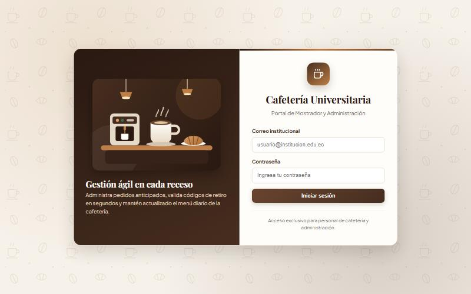

**Resultado:** se abre el **Mostrador de Cafetería**, con tres secciones: **Panel de Pedidos**, **Validar Código de Retiro** y **Gestión del Menú**. La cuenta de trabajador la crea el administrador.

### 4.2 Atender la cola de pedidos

1. En **Panel de Pedidos**, elige un filtro: **Pendientes**, **En preparación**, **Listos para retirar**, **Entregados** o **Todos**. Cada uno muestra cuántos pedidos tiene.
2. Pulsa **Ver detalle** para revisar los productos.
3. En un pedido pendiente, pulsa **Iniciar preparación**.
4. Cuando esté preparado, en el filtro **En preparación** pulsa **Marcar listo**.

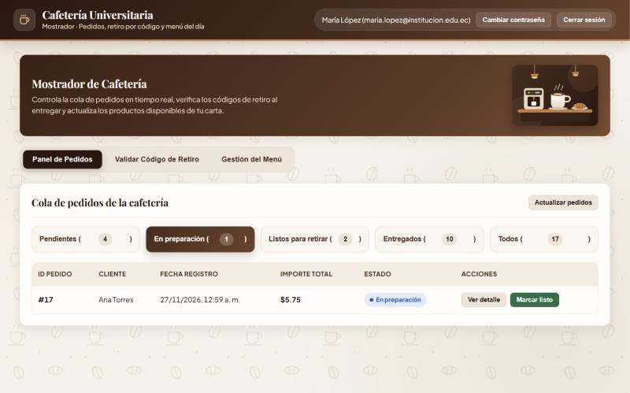

**Resultado:** un aviso confirma el cambio y el pedido pasa al siguiente filtro. No se puede saltar ni retroceder un estado.

La cola se actualiza sola cada 15 segundos mientras no haya una ventana de detalle abierta. También puedes pulsar **Actualizar pedidos**.

### 4.3 Validar el código y entregar el pedido

**Antes:** el pedido debe estar **Listo para retirar**.

1. Abre **Validar Código de Retiro** (o pulsa **Validar retiro** en el pedido listo).
2. Selecciona el pedido en **Pedido listo para retirar**.
3. Escribe el código de 6 caracteres que presenta el cliente.
4. Pulsa **Comprobar código**. Esto no cambia el estado.

Si el código es incorrecto, aparece este aviso y **no se debe entregar el pedido**:

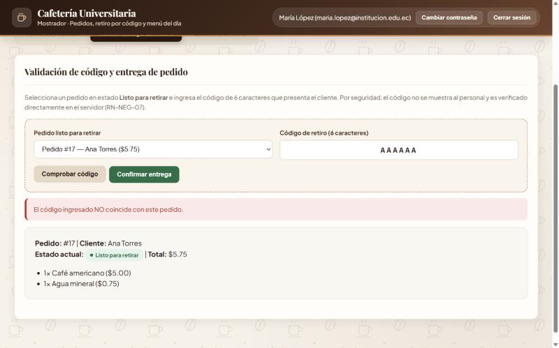

Si es correcto:

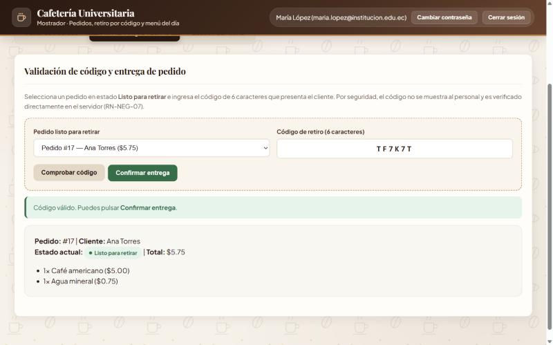

5. Verifica los productos, cobra y pulsa **Confirmar entrega**.

**Resultado:** el pedido queda como **Entregado**.

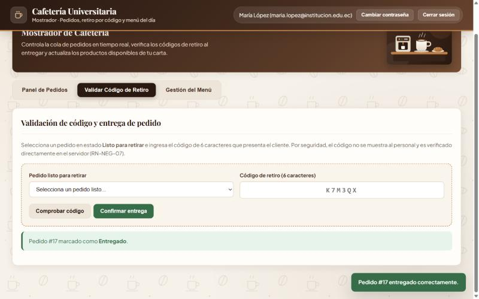

El sistema no muestra los códigos al personal: siempre debe presentarlo el cliente. Los códigos no usan las letras `I` y `O` ni los números `0` y `1`.

### 4.4 Registrar un producto

1. Abre **Gestión del Menú**.
2. Completa **Nombre del producto** (de 2 a 60 caracteres), **Precio (USD)** (mayor que 0, hasta 999.99, con máximo 2 decimales) y **Tipo de producto**.
3. Si quieres, selecciona una **imagen** JPG, PNG o WEBP de hasta 2 MB.
4. Pulsa **Guardar producto**.

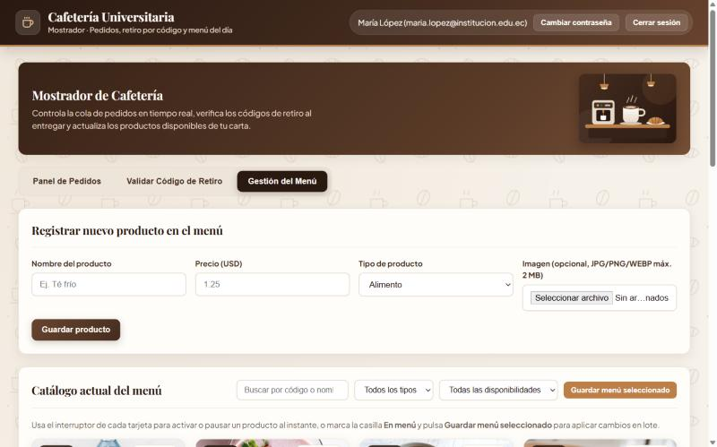

**Resultado:** el producto se registra como disponible. No se admiten dos productos con el mismo nombre.

### 4.5 Cambiar la disponibilidad

En **Catálogo actual del menú**, usa el interruptor de la tarjeta para marcar un producto como **Disponible** o **No disponible**. El cambio se guarda al instante y solo los disponibles aparecen a los clientes.

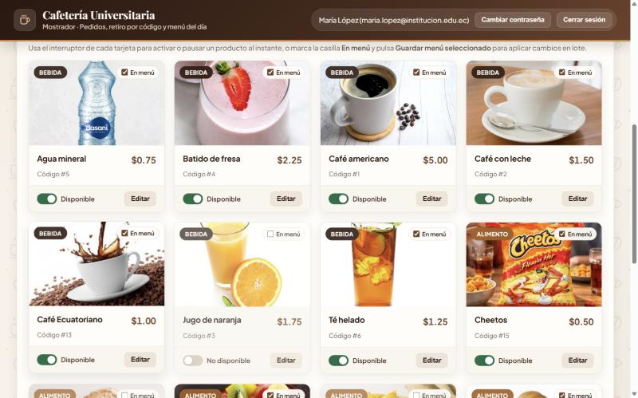

Para cambiar varios a la vez:

1. Marca **En menú** en los productos que deban estar disponibles y desmarca los que no. Los que ya están disponibles aparecen marcados.
2. Si lo necesitas, usa la búsqueda o los filtros para encontrarlos. Al filtrar, los productos solo se ocultan y conservan sus marcas.
3. Pulsa **Guardar menú seleccionado**.

**Resultado:** los productos marcados quedan disponibles y los desmarcados pasan a no disponibles, incluidos los que un filtro o una búsqueda tengan ocultos. Un aviso indica cuántos productos quedaron disponibles.

Los cambios en las casillas **En menú** no se guardan hasta pulsar el botón: si recargas la página o sales, se pierden. Debe quedar al menos un producto marcado.

### 4.6 Editar un producto

1. Pulsa **Editar** en la tarjeta del producto.
2. Cambia el nombre, el precio, la disponibilidad o la imagen.
3. Pulsa **Guardar cambios**, o **Cancelar** para salir sin guardar.

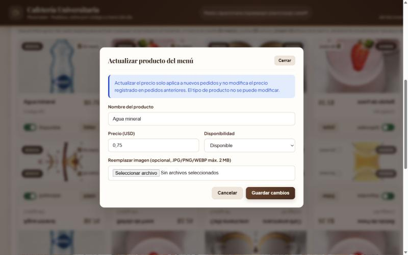

El nuevo precio se aplica solo a pedidos nuevos; los anteriores conservan el suyo. El tipo de producto no se puede cambiar.

---

## 5. Administrador

El administrador ingresa por el portal del personal ([4.1](#41-iniciar-sesión)) y accede al panel de **Administración de Cafetería**.

### 5.1 Crear una cuenta de trabajador

1. Abre **Gestión de Trabajadores**.
2. Completa nombre, apellido, cédula ecuatoriana, correo institucional, contraseña inicial y su confirmación.
3. Pulsa **Registrar trabajador**.

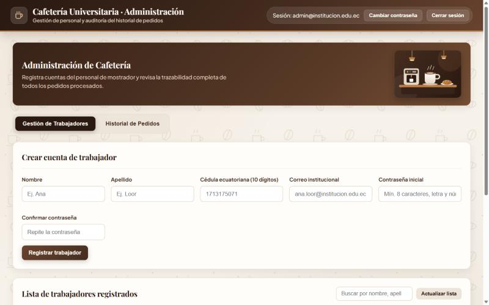

**Resultado:** aparece «Cuenta de trabajador registrada correctamente». Entrega la contraseña inicial de forma privada y pide al trabajador que la cambie.

### 5.2 Consultar la lista de trabajadores

En **Lista de trabajadores registrados**, busca por nombre, apellido o cédula. Pulsa **Actualizar lista** para recargarla.

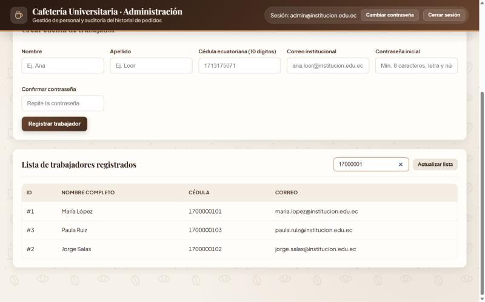

### 5.3 Consultar el historial de pedidos

1. Abre **Historial de Pedidos**.
2. Para ver un pedido concreto, escribe su número y pulsa **Buscar**. **Ver todos** quita el filtro.
3. Usa **Anterior** y **Siguiente** para cambiar de página.

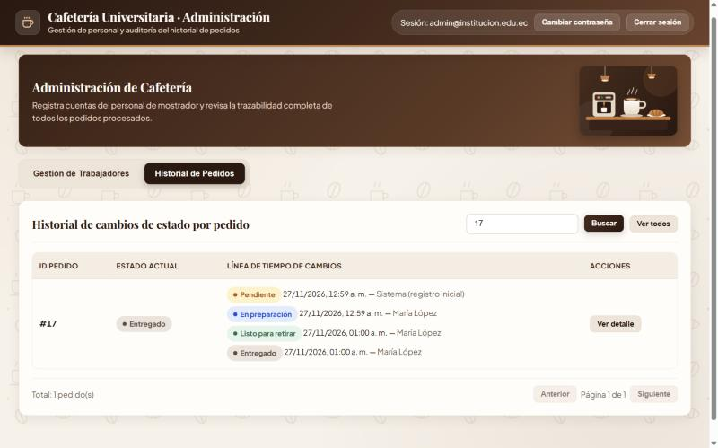

La línea de tiempo muestra cada estado, su fecha y quién lo registró. Pulsa **Ver detalle** para ver además el cliente, los productos y los importes.

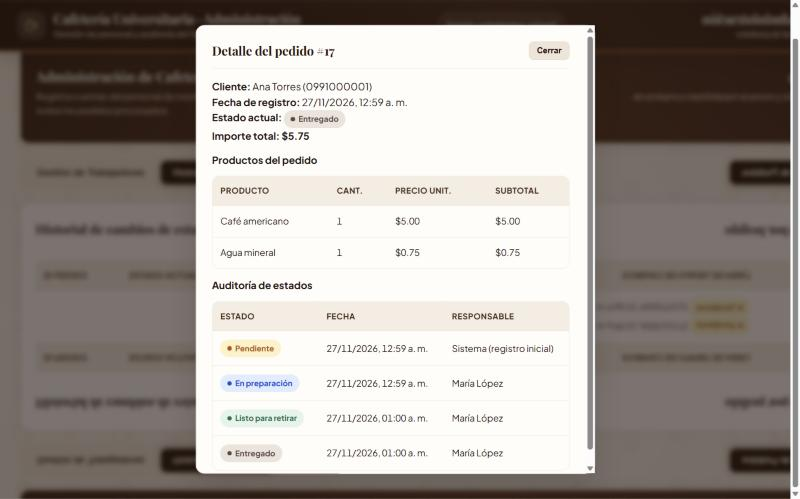

---

## 6. Cambiar la contraseña y cerrar sesión

### 6.1 Cambiar la contraseña (todos los usuarios)

1. Pulsa **Cambiar contraseña** en la parte superior.
2. Escribe la **contraseña actual**, la **nueva** y su **confirmación**.
3. Guarda los cambios.

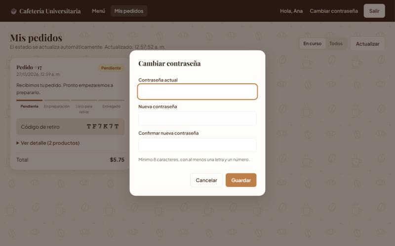

La nueva contraseña debe ser distinta de la actual y cumplir los requisitos de la sección 2. El sistema no ofrece recuperación de contraseñas olvidadas.

### 6.2 Cerrar sesión

- **Cliente:** pulsa **Salir**.
- **Trabajador y administrador:** pulsa **Cerrar sesión**.

---

## 7. Problemas frecuentes

| Mensaje o situación | Qué hacer |
|---|---|
| «Correo o contraseña incorrectos» | Revisa el correo y la contraseña. |
| «Esta cuenta pertenece al personal de la cafetería. Usa el portal del personal.» | Ingresa por el portal del personal. |
| «Esta cuenta corresponde a un cliente. Usa el portal de clientes.» | Ingresa por el portal de clientes. |
| «Debe usar su correo institucional» | Regístrate con tu correo `@institucion.edu.ec`. |
| «Ya existe una cuenta con este correo» | Ingresa con esa cuenta. |
| «La cédula no es válida» | Revisa los 10 dígitos. |
| No encuentro un producto | No está disponible, o tienes un filtro o búsqueda activos. |
| No aparece un pedido en **En curso** | Si ya fue entregado, está en **Todos**. |
| El pedido no está en la lista de validación | Primero debe marcarse como **Listo para retirar**. |
| «El código ingresado NO coincide con este pedido» | Comprueba que seleccionaste el pedido correcto y pide el código otra vez. |
| La página vuelve a la pantalla de acceso | La sesión terminó: ingresa de nuevo. |
| La página no carga | Verifica tu conexión y avisa al responsable del sistema. |

---

## 8. Relación con las historias de usuario

| Historia | Sección |
|---|---|
| HU-CLI-01 Consultar menú y precios | 3.3 |
| HU-CLI-02 a 04 Seleccionar, revisar el importe y validar | 3.4, 3.5 |
| HU-CLI-05 Confirmar y obtener el código | 3.5 |
| HU-CLI-06 Consultar el estado | 3.6 |
| HU-CLI-07 Registrarse | 3.1 |
| HU-PER-01 Registrar un producto | 4.4 |
| HU-PER-02 Actualizar nombre o precio | 4.6 |
| HU-PER-03 Cambiar disponibilidad | 4.5 |
| HU-PER-04 a 06 Atender la cola | 4.2 |
| HU-PER-07 Verificar el código y entregar | 4.3 |
| HU-USU-01 Cambiar la contraseña | 6.1 |
| HU-USU-02 Iniciar y cerrar sesión | 3.2, 4.1, 6.2 |
| HU-ADM-01 y 02 Crear y listar trabajadores | 5.1, 5.2 |
| HU-ADM-03 Consultar el historial | 5.3 |
